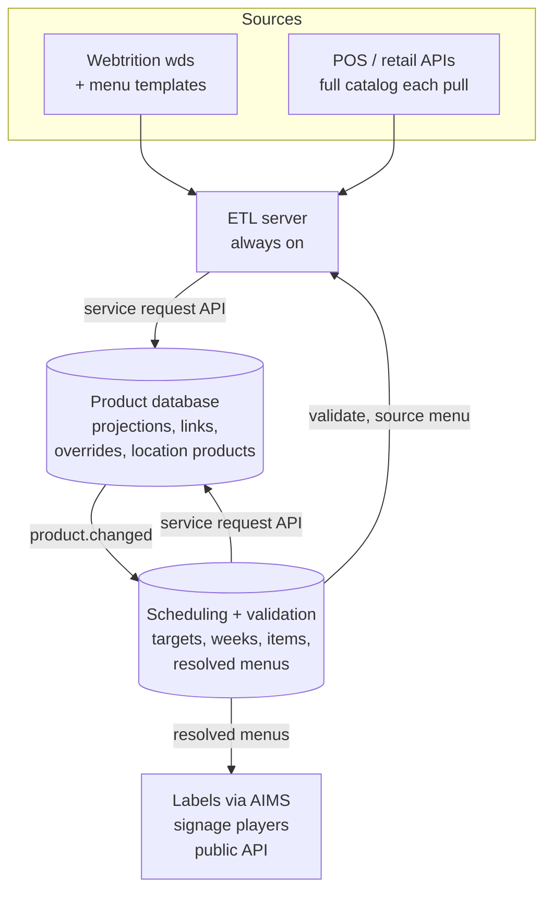
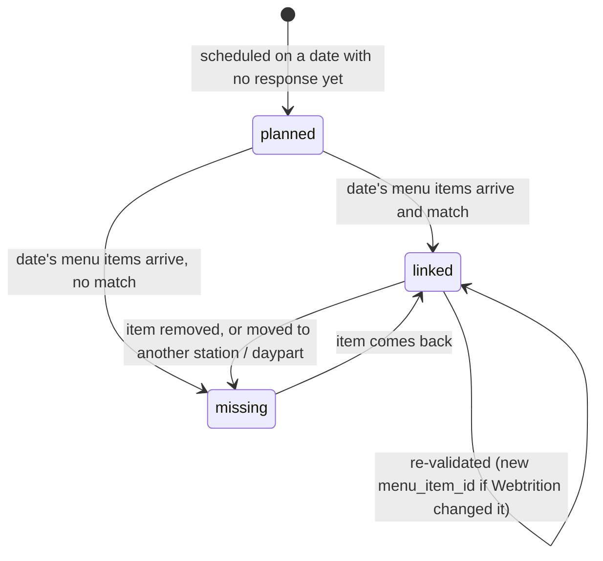
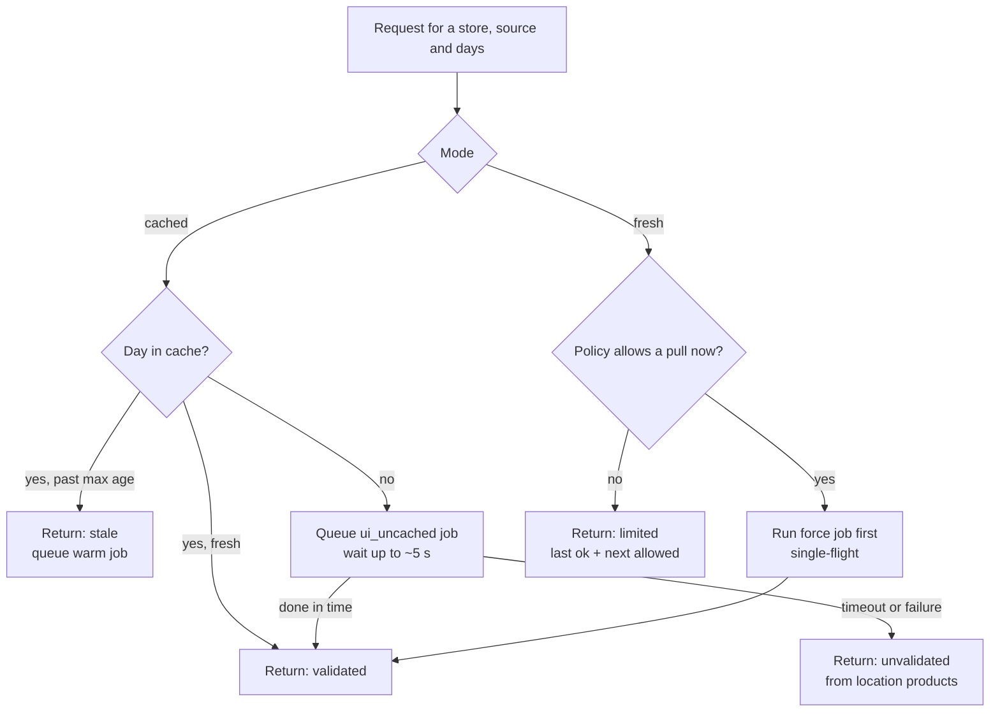

# Menu Platform Design: Product Database, ETL and Scheduling

| | |
|---|---|
| **Status** | **Proposed — awaiting approval.** No build work starts until this is approved. |
| **Version** | 2.4 · 2026-11-25 |
| **Owner** | Eric Melgaard |
| **Scope** | Three connected systems behind Operator Hub menus: the **product database** (what an item is), the **ETL server** (every call to Webtrition and POS sources) and **scheduling + validation** (where and when an item shows on smart labels and signage menu zones). Infrastructure, SQL tables, logic, APIs, security, service levels, UI representation and requirements for all three. |
| **Source of truth** | This file: `MENU_PLATFORM_DESIGN.md` in the public repo [`ericmelgaard/menu-platform-spec`](https://github.com/ericmelgaard/menu-platform-spec). Rendered at https://ericmelgaard.github.io/menu-platform-spec/ (rebuilt on every push). Any rendered page is a copy of it. Change this file first, add a row to the change log, then rebuild. |
| **Proposed — confirm** | Items marked this way are recommendations waiting for the owner's decision; they're listed in §19. Build to them unless §19 says otherwise. |

## Using this document

This document is the single, connected reference for three systems that only work together: the
**product database**, the **ETL server** and **scheduling + validation**. They share identities
(products and their variants, MRN, POS item ids), events and data, so they're specified in one place: a change to
one is checked against the other two here. It covers the infrastructure, the SQL tables, the logic, the
APIs and what the UI must show, and it's written so that people and AI coding agents can answer build
questions from it directly.

| System | Specified in |
|---|---|
| **Product database** | §2, §7 (tables), §11 F3, F4, F9, F9b (flows), §12.1 (API), `R-PD-*`, `R-DB-*` |
| **ETL server** | §2, §5 (freshness and sync), §8 (tables), §11 F1–F3 (flows), §12.2 (API), `R-ETL-*`, `R-INF-*` |
| **Scheduling + validation** | §2, §4 (life of a menu item), §9 (tables), §11 F5–F15 (flows), §12.3–12.6 (APIs), `R-SCH-*`, `R-API-*` |
| **Shared by all three** | §3 infrastructure, §6 identities, §10 retention and scale, §13 security, §14 service levels, §15 UI, §17 build plan, §18 decisions |

**Where to find what**

| Question | Read |
|---|---|
| What is this platform and why is it built this way? | §1 Goals, §2 Architecture, §4 Life of a menu item |
| What's the product database spec? | §1.1, §7 tables, §12.1 service request API, F3, F4, F9, F9b, `R-PD-*` |
| What does the ETL do, and what does it store? | §1.2, §5 freshness and sync, §8 tables, F1–F3, §12.2, `R-ETL-*` |
| What does scheduling do, and what does it store? | §1.3, §4, §9 tables, F5–F15, §12.3–12.6, `R-SCH-*`, `R-API-*` |
| How do the three systems talk to each other? | §2, §3 (I1, I4, I7), §12.1–12.3, events in F9 and F12 |
| What infrastructure do we need? | §3 Infrastructure choices, §10.4 Scale, §13 Security, §14 Service levels, requirements `R-INF-*` (§16) |
| What SQL tables do we need? | §7 Product database, §8 ETL, §9 Scheduling, §10 Retention, requirements `R-DB-*` |
| How does data stay fresh? What is cached, what is computed? | §5 Freshness and sync, §5.7 Compute on change, look up on read |
| What does a device or partner receive? | §12.4 Menu response, §12.5 Offline package, §12.6 Errors and limits |
| How does a specific behavior work? | §11 Logic flows (`F1`–`F15`) |
| How do people, devices and services authenticate? | §13 Security and access |
| What must the UI show? | §15 UI representation, requirements `R-UI-*` |
| What is the testable list of requirements? | §16 Requirements (every one traces to a section) |
| In what order do we build, and how do we know a phase is done? | §17 Build plan |
| Why was a choice made? | §18 Decisions (`D1`–`D59`) |
| What is still undecided? | §19 Open items and proposed decisions |

**Instructions for AI agents using this document**

- Treat this file as the source of truth. Answer from it, and cite the section, flow (`F…`), decision
  (`D…`) or requirement (`R-…`) you used.
- Use the table and column definitions in §7–9 as written. Don't invent tables, columns, states or
  endpoints. If something needed isn't here, say so and point to §19 rather than filling the gap.
- Items marked **Proposed — confirm** are the current plan; mention that they're awaiting confirmation.
- For UI work, check §15 and the `R-UI-*` requirements, and follow the repository's UI style guide
  (`CLAUDE.md` in the Operator Hub repo, `OpHub_Playground`) for components and wording.
- If code and this document disagree, this document wins until it's changed on purpose (change it first,
  then the code).

## 1. Goals and non-goals

Shared goals:

- Support two kinds of menu with one platform:
  - **Webtrition menus**: scheduled at the site on a menu cycle (usually 4 weeks). Webtrition is the
    system of record for those items. WAND adds site and company enrichment, validates items against
    the day's menu, and places them in the right positions.
  - **Retail menus**: relatively static. The WAND product database is the system of record. Items are
    seeded at the concept and linked to any number of POS APIs.
- Keep every store working when a source (Webtrition, a POS) is down.
- Hold only the data that's needed, for as long as it's needed (§10).
- Nothing slow in front of the UI. Run as an enterprise service (§10.4).

### 1.1 Product database

- Every item on a menu is a **projection**: a WAND product over one or more linked sources plus
  overrides at concept, company and store (§7).
- Source data keeps flowing in for mapped attributes; links fill attributes in priority order; a POS
  can be swapped by remapping, never by re-creating products.
- Retail projections are owned by the concept; Webtrition and custom projections by the company.
- Each store has an always-available, resolved product set (`location_products`).
- Reached by every other system only through its service request API (§12.1).

### 1.2 ETL server

- The only system that calls Webtrition or a POS.
- Seeds a store's menu cycle, detects new menu templates, validates here and now on each source's sync
  policy, answers uncached and forced requests within source limits (§5).
- Holds the short-lived validation cache and the POS staging catalogs; creates and refreshes
  projections in the product database.

### 1.3 Scheduling + validation

- Schedules what each smart label and signage menu zone shows, by daypart, day and week, from a
  Default Week plus week overrides and recurring weeks (§4.7).
- **For Webtrition, schedules against the validation response**: what can be scheduled on a date is
  what Webtrition has on the menu for that date; the product database enriches it and keeps a
  placement's identity across dates (§4).
- Resolves menus when something changes and serves them to devices, signage and partners, online and
  offline (§5.7, §12.4, §12.5).

**Non-goals**

- How attributes display on labels or signage (out of stock, badges, colors). Out of stock is just an
  attribute here.
- Rebuilding Webtrition's recipe, menu or cycle systems.
- **Product database features menus don't need.** This document specifies the product database only as
  far as menus require (projections, links, attribute maps, overrides, store product sets, POS mapping,
  catalogs, terms, categories). Images, variations, customizations and the other product editing
  features are outside its scope and must not conflict with the tables here.
- The existing playground product tables. The product database can be built new.

## 2. Architecture

Three systems with separate responsibilities.



| System | Owns | Never does |
|---|---|---|
| **ETL server** | Every call to a source. Attribute maps. The Webtrition validation cache (this week and next). POS staging catalogs. Creating and refreshing projections. | Store schedules or local overrides |
| **Product database** | What an item *is*: projections, source links, harvested values, overrides at concept / company / store, and each store's always-available product set (`location_products`). Reached only through its **service request API**. | Know which day or target an item is on |
| **Scheduling + validation** | Where and when an item shows: targets, Default Week, weeks, placements, menu item links, order locks, resolved menus. For Webtrition targets it works from the **validation response first**. | Call a source directly, or store product attributes beyond a one-week override |

## 3. Infrastructure choices

| # | Choice | Why | Rejected |
|---|---|---|---|
| I1 | **Three separate systems** (ETL, product DB, scheduling) | The product database serves many APIs and locations beyond menus. Scheduling only places items. Source calls stay in one place. | One combined menu service: mixes the system of record with placement, and source outages leak into the UI |
| I2 | **ETL is an always-on service** answering direct calls. Background work runs on workers or a nightly job. | Rule: no slow DAGs in front of a UI. `validate` and `source-menu` are called while a person waits. | Airflow DAGs on the request path. Airflow is allowed only for the nightly batch. |
| I3 | **Day-level validation cache in the ETL** (`source_menu_days`): 1-day pulls for here-and-now validation, 7-day pulls for planning | Freshness is per day; today can be re-validated every 15 minutes without re-pulling the week. WAND's wds route never caches items, so this *is* the cache, and it keeps a stale copy when a source is down. | Week snapshots only. Calling the source per request. Keeping dated Webtrition items long. |
| I4 | **Product database behind a service request API** | Many callers (scheduling, ETL, other apps). Lets the product DB change inside without breaking callers. | Shared tables joined directly by scheduling |
| I5 | **`location_products`: a resolved product set per store**, rebuilt on change | Enrichment for every item, the primary list for retail, and the fallback when Webtrition can't answer. A store works when sources are down. | Resolving through the source chain on every read |
| I11 | **Webtrition scheduling reads the validation response first** (§4) | Webtrition is the system of record for what is on a menu on a date; WAND schedules and validates against that | Scheduling from the product database and only checking against Webtrition afterwards |
| I12 | **Placements store identity, links are made per date** (`menu_item_links`) | Menu item ids change every day; a placement must survive until its date's menu item exists, and keep a visible record of what it matched | Storing a menu item id on the placement; keeping matches only inside cached menus |
| I14 | **A compact record of what was shown** (`shown_menus`) for past days | Past days never change and must be answerable ("what did the label show last Tuesday?") even after products are renamed or repriced | Rebuilding past days from today's product data |
| I15 | **Every date is readable by UI and API the same way** (§5.6) | An endpoint asking for a future date must get the same answer the UI shows | API reading only the cached window |
| I13 | **Dated rows stay slim; detail is stored once per product**; date-keyed tables are partitioned by date | Keeps the cache about 10x smaller (§10) and makes retention a partition drop | Nutrition and allergens copied onto every dated row |
| I6 | **Resolved menus cached** for this week and next, with a hash | Devices, signage, the AIMS push and the public API read only this. The hash decides whether to push. | Resolving on every device request |
| I7 | **Events, not polling**, between systems (`product.changed`) | Product and price changes reach menus right away without scans | Nightly reconciliation only |
| I9 | **Sync policies in data** + an always-on **policy scheduler** with a priority queue, per-source rate limiter and single-flight (§5) | Sources differ and change (Webtrition every 15 min, PAR once a day). A POS rule change is a row change. Forced and UI requests jump the queue but still respect source limits. | Fixed cron per source; hard-coded intervals |
| I10 | **Change feed + webhooks + ETag polling** for endpoints (§5.5) | Validated changes during the day reach labels and signage automatically, by push or cheap poll | Endpoints re-pulling whole menus on a timer |
| I8 | **Postgres** for all three. Playground: one Supabase project with schemas `product`, `etl`, `schedule`. | Matches today's stack. Schemas keep the boundaries real. | Separate databases in the playground |

**Where it runs**

| Piece | Production | Playground |
|---|---|---|
| ETL server | WAND service (always on) + workers | Supabase edge function (`populate-menu-data` grows into it) + `pg_cron` |
| Product database + service request API | WAND service on Postgres | `product` schema + RPC functions standing in for the API |
| Scheduling + validation | WAND service on Postgres | `schedule` schema + edge function |
| Events | Queue or webhook | Trigger + `pg_notify` |
| Policy scheduler, queue, rate limiter | ETL workers (always on) | `pg_cron` every minute reading `source_sync_status.next_due_at` + a jobs table |
| Change feed dispatch (webhooks) | Worker with retries | Edge function on a `pg_cron` tick |
| Nightly / rollover / retention | Scheduled job (Airflow allowed here) | `pg_cron` |

**Why not Airflow for the core.** Airflow is a batch orchestrator. Most of this system is a person or a
device asking for an answer in seconds (validate today, fetch an uncached week, force a refresh), and an
Airflow run takes seconds to minutes to start and returns nothing to the caller. Validating every store
every 15 minutes is about 96 tiny runs per store per day, which Airflow's scheduler isn't built for.
Per-source rules (PAR once a day, forced pulls that still respect quotas, single-flight) don't map onto
pools and priority weights, and policies that change at runtime fight DAGs defined in code. The core
runs on an always-on service with a durable job queue (Postgres-backed such as pg-boss or Graphile
Worker, or SQS / Redis). Airflow is acceptable only for the light scheduled batch: the daily template
check, seeding, the Saturday rollover and retention.

## 4. Life of a menu item

This section is the core of the design for Webtrition targets: what the scheduler sees for a date,
when a scheduled item becomes a real menu item, and how the link holds while it does.

### 4.1 Who answers "what is on the menu"

| Target | Primary input for a date | Product database role |
|---|---|---|
| **Webtrition** | The **validation response**: that date's Webtrition menu items, from the ETL (§5) | Enrichment (site and company values, translations, POS price), the identity that carries a placement across dates, and the fallback when there's no response for the date |
| **Retail** | The product database (`location_products`, categories) | Primary |

So for a Webtrition label, the items offered for Tuesday lunch are the menu items Webtrition has for
that Tuesday and meal period, shown with their WAND values. Searching the product database adds
anything else, shown as not on that day's menu.

### 4.2 Three kinds of item in a schedule

| Kind | What it is | Stored where |
|---|---|---|
| **Menu item** | Webtrition's item for one date, daypart (meal period) and station (`menu_item_id`) | ETL day cache, short-lived (§10) |
| **Variant** | A recipe (MRN) served at one station in one daypart; its own name, portion, price and overrides, inheriting the rest from the recipe | `product_variants`, kept with the product |
| **Placement** | "This variant (recipe + station + daypart), on this target's daypart page, on these days" | `menu_week_items`; never holds a menu item id |
| **Menu item link** | A placement matched to a menu item on one date, with its state | `menu_item_links`, one row per placement per date |

### 4.3 States of a placement on a date



| Link state | Meaning |
|---|---|
| `planned` | Scheduled on a date with no Webtrition menu items yet. Either Webtrition **hasn't published** the date (past the active template's end date, or the next template isn't set up yet), or the date **hasn't been fetched** (freshness `unvalidated`). Not a menu item yet; it links by itself if the date's menu, when it arrives, includes it. |
| `linked` | Matched by the variant (MRN + station + daypart) to that date's menu item, bound to its `menu_item_id`. A portion change on the day doesn't break the link; it updates the variant's values |
| `missing` | Webtrition answered for the date and has no match |

Each link also carries its freshness from §5.3 (`validated`, `stale`, `unvalidated`, `limited`), taken
from when that date was last fetched.

**No pretend menus (D59).** For a date Webtrition hasn't published, the system never offers a predicted
menu. The seeded cycle belongs to the current template, and the next template may be completely
different, so projecting it forward would suggest a menu that doesn't exist. Instead the UI says the date
isn't published yet, the pick list falls back to product search, and each product's usual weekdays and
meal periods (from `location_products`) are shown only as a hint.

How a date counts as not published: Webtrition answers for the store and date with no menu data (wds
returns no items, or its "no menu data" error). The ETL records the day as `not_published` in
`source_menu_days` and re-checks it on the normal planning and validation schedule, so the date starts
linking as soon as Webtrition publishes it.

### 4.4 How the link stays in place

- A placement holds the **variant**: the recipe (MRN) at one station in one daypart. It never holds a
  menu item id, because those are per date.
- Every time a date's menu items are fetched (opening the week, a forced refresh, here-and-now
  validation, the date entering this week or next), each placement on that date is matched again and
  its `menu_item_links` row is written.
- `planned` becomes `linked` by itself when the date's menu items arrive. Nobody re-adds anything.
- One placement links to a different `menu_item_id` on each day of the week.
- The Default Week is **followed by reference**: weeks that follow it hold no copies. Copying a week and
  recurring copy **placements** (new ids), never links. Links are always made for the actual dates.
- If Webtrition moves the recipe to another station or daypart, that date becomes `missing` (a
  different station + daypart is a different menu item). The link records a `moved_to` hint (the
  variant it now appears as) so the UI can offer the swap in one click; it never relinks by itself.
- A different portion for the same recipe, station and daypart is the **same** item: the link stays
  `linked` and the day's portion shows.
- On the day, an Auto placement that's `missing` doesn't show (it follows the source); one forced On
  still shows, flagged.

### 4.5 Example: Chicken Tenders, three weeks out

1. **Seed.** The cycle seed made a projection for MRN 13404 (the recipe) with a variant for Grill +
   Lunch (portion "1 each"). The store's product set knows that variant is usually served Monday to Friday.
2. **Plan.** On Nov 25 a manager opens the week of Dec 13. Nothing is cached, so the scheduler asks the
   ETL for Dec 13–19 (an on-demand pull, §5.1). Webtrition has published those dates, so the lunch list
   is that response. The manager adds Chicken Tenders to the Grill label's lunch page for Tuesday; the
   Grill + Lunch variant is chosen for them because that's the page's daypart and the only Grill offering. A
   placement is stored; its Dec 15 link is `linked` to that day's menu item. The fetched days are
   dropped from the cache once stale; the placement and link stay.
   - If Webtrition hadn't published Dec 13–19 yet (say they fall after the current template's end
     date), the week would say so. There'd be no menu list; the manager would find Chicken Tenders in
     product search (its usual days, Mon–Fri at lunch, shown as a hint), and the Dec 15 link would be
     `planned` until Webtrition publishes that date.
3. **Approach.** When the week of Dec 13 becomes next week, opening it re-fetches the dates and
   re-matches. The link updates if Webtrition changed the menu item id.
4. **The day.** On Dec 15 here-and-now validation runs every 15 minutes. The link stays `linked` and
   `validated`; the label shows the item. If Webtrition removes it at 11:00, the link turns `missing`,
   the resolved menu changes, the change feed records it and the label updates.
5. **After.** The placement and its links are kept with the schedule for 8 weeks, then purged (§10).

### 4.6 How a weekly menu is stored: Webtrition and custom items together

A week holds only *placements*: which product goes where, on which days. Names, prices and nutrition
are never copied into a week, so every read gets current values, and a week stays small.

**Example:** the Grill Station label's lunch page for the week of Dec 13 holds a Webtrition item and a
custom item.

| Row | Table | Holds | Size |
|---|---|---|---|
| The week | `menu_weeks` | target, `week_start = 2026-12-13`, origin (Default Week / copy / recurring), `edited` | ~150 B |
| Chicken Tenders placement | `menu_week_items` | product id (company projection for MRN 13404), variant Grill + Lunch, `on_mask` / `off_mask` (Auto = follow Webtrition), sort keys, any this-week override | ~300 B |
| Chicken Tenders, Tue Dec 15 | `menu_item_links` | `linked`, menu item id for that date, when the date was fetched | ~80 B |
| Soup of the Day placement | `menu_week_items` | product id (company custom projection), no meal period, days Mon–Fri forced On | ~300 B |
| Soup of the Day links | none | Custom and retail items have no source dates, so no links; always available | 0 |

- **Values at read time.** Chicken Tenders gets its name and price from that day's Webtrition menu item
  (validation response), then the Grill + Lunch variant's values, then the recipe's company and store values from the product database, then any
  this-week override. Soup of the Day gets everything from the product database. A retail item works the
  same way, with its POS price harvested per the POS sync policy.
- **Default Week** placements are stored once under the target's Default Week row, with day masks and
  no dates. Weeks that follow the Default Week have **no row and no copies**; reading any date in them
  resolves straight from these placements (§4.7). A retail menu that never changes is one set of
  placements, kept forever.
- **Size:** a target's page is a few kilobytes a week; 50 targets is about 1 MB a week of placements,
  plus links for Webtrition placements only (§10.2).
- **Updates:** because only identities are stored, a product edit or a new validation result changes
  what every week shows the next time it's resolved: at once for today through next week (events), and
  on access for later weeks (§5.6). Past days are read from what was shown (§9, `shown_menus`).
- **Days that follow another meal period.** A placement can follow a different Webtrition meal period
  than its page (`follows_meal_period_id`): a Brunch item on the Breakfast page shows on the days Brunch
  offers it.
- **Hidden autofill items.** Removing an autofilled item stores a placement with `state = 'hidden'`, so
  autofill doesn't bring it back that week.

### 4.7 Which placements apply to a date: Default Week, recurring and edited weeks

For a target and a date, the scheduler takes the first that exists:

1. **The week's own schedule**: a `menu_weeks` row for that week (`kind = 'week'`). It exists only
   when someone edited that week (an Override), copied or pasted into it, or a recurring week was
   applied to it.
2. **A recurring week that lands on it**: a week marked to repeat every N weeks from its start date,
   until its optional end date. On first access to a week it lands on, its placements are copied into a
   new week row for that week (new items for the new week, per the original requirement), with
   `origin = 'recurring'` and `edited = false`.
3. **The Default Week**, by reference. No row, no copies.

| | Default Week | A week set to repeat |
|---|---|---|
| What it is | The base for any week with no schedule of its own | A real, dated week that repeats every N weeks from its start date, until an optional end date |
| Dates | None; days of the week only | Starts on a date; can alternate (every 2 weeks, a rotation) |
| Its items | Special items, stored once | Each occurrence gets new items for its week (copied on first access) |
| Later edits to the original | Apply at once to every week that follows it | Reach occurrences that are still unedited (`edited = false`) |
| Precedence | Lowest: used when nothing else applies | Beats the Default Week on the weeks it lands on |
| Best for | A menu that basically never changes (a retail brand) | Rotations, or "from Jan 4, every week is this" while the Default Week stays the fallback |

Editing a week that follows the Default Week creates its row and copies the Default Week's placements
into it, then applies the edit; from then on it's an Override and stops following the Default Week.

## 5. Freshness and sync strategy

This is the core of the system: how single-day validation, UI requests for uncached dates, forced
refreshes and source limits fit together, and how validated changes reach endpoints.

### 5.1 Four kinds of data request

| Request | Example | Granularity | Served from | Speed target |
|---|---|---|---|---|
| **Here and now** (validation) | Is today's lunch still right? | **1 day** (today; tomorrow near close) | Source, on the store's sync policy (Webtrition about every 15 min) | Background; endpoints never wait |
| **Planning** (this week, next week) | Opening next week in the UI | 7 days per call | Day cache, refreshed when opened if older than its max age | Cache: instant |
| **Future, not cached** | Opening a week 3 weeks out | The requested days | Source on demand, single-flight; kept briefly | One source call (seconds); UI shows a loading state, falls back to projections |
| **Force fresh** | "Refresh now" in the UI, or an operator call | The requested days | Source now, bypassing the cache, **if the source policy allows it** | One source call; if not allowed, answer with the last sync time and when the next is allowed |

Seeding a cycle (F1) is a fifth, bulk kind, and it runs only **at setup and when Webtrition activates a
new menu template**. After the first seed, keeping seed data current matters little: menu item
validation (here and now, plus UI interaction) catches nearly every change, and a person can update a
single projection on demand (F9b) when they need to see a recipe change.

### 5.2 Sync policy per source and store

Every source and store has a policy, because sources differ and change (Webtrition can be pulled every
few minutes; PAR POS allows one sync a day; a POS may raise or lower its limits).

| Setting | Meaning | Webtrition | PAR POS (example) |
|---|---|---|---|
| `validate_every` | How often "here and now" runs | 15 min | 1 day |
| `validate_days` | Days each validation pulls | 1 (today) | full catalog |
| `max_age` | Older than this, data counts as **stale** | 30 min | 26 h |
| `min_interval` | Shortest gap the source allows between pulls | none | 24 h |
| `daily_quota` | Pulls per day the source allows | none | 1 |
| `force_allowed` | Can a person force a pull | yes | only if quota left |
| `window` | Hours when validation runs (store hours plus lead time) | open − 1 h to close | overnight |

Policies live in data (`source_sync_policies`, §8), so a POS rule change is a row change, not a deploy.
Attributes that need faster change detection (out of stock) can only be as fresh as the source allows;
the policy states that honestly.

### 5.3 Validation states

Every resolved item carries how trustworthy its data is:

| State | Meaning | Shown and used? |
|---|---|---|
| `validated` | Source data younger than `max_age` | Yes |
| `stale` | Source data older than `max_age` (source down, quota used) | Yes, flagged; validation keeps retrying per policy |
| `unvalidated` | No source data for that day yet (future date not fetched, new store) | Yes, from `location_products`; flagged. The link state is `planned` (§4.3) |
| `limited` | A forced refresh was refused by the source policy | Yes; the UI says when the next pull is allowed |

Rule: **endpoints always get something.** A source outage downgrades the state, never empties a menu.
Validation still runs on its requirement and upgrades the state when the source returns.

### 5.4 Patterns

- **Day-level cache.** Source data is cached per store, source and service date (`source_menu_days`).
  A 1-day validation replaces one day; a week load writes seven. Each day row has its own `fetched_at`,
  so freshness is per day.
- **Policy scheduler.** An always-on worker keeps `next_due_at` per store and source, and queues
  validation when due (inside the window, outside the quota limits). No DAGs.
- **Priority queue.** Order: forced (a person is waiting) → UI open of an uncached date → here-and-now
  validation → planning warm-up → seeding. A per-source rate limiter enforces `min_interval` and
  `daily_quota` for every job, forced ones included.
- **Single-flight.** Concurrent requests for the same store, source and day share one source call.
- **Stale-while-revalidate.** Reads return the cache at once with its state; if it's past `max_age`, a
  refresh is queued. Only force-fresh and uncached-date requests wait for the source, with a timeout
  that falls back to `stale` / `unvalidated`.
- **Short-lived future days.** Days fetched for a future week stay cached until they're older than
  `max_age` or fall outside this week and next; then they're dropped. Webtrition days are never kept
  long.
- **Change detection by hash.** Each day row stores a payload hash. Same hash: only `fetched_at`
  moves. Different hash: upsert projections, rebuild `location_products`, emit `product.changed` /
  `menu.source_changed`, and re-resolve affected menus.

How a request for source data is answered:



### 5.5 Getting changes to endpoints

Validated changes must reach labels, signage and other endpoints automatically, ad hoc, during the day.

1. A re-resolve (F6) that produces a new hash for a target / day / daypart writes a row to
   **`menu_change_feed`** (a sequence number, target, date, daypart, hash).
2. **Push:** a dispatcher sends each change to subscribed webhooks (`endpoint_subscriptions`), with
   retries and backoff. The AIMS push is one such subscriber.
3. **Poll:** endpoints that poll call `GET /menus?target&date&daypart` with `If-None-Match` (the hash
   as ETag) and get `304` when nothing changed, or `GET /changes?since=<seq>` for everything since
   their last sequence.
4. Only today's changes are pushed during the day; future-day changes are delivered when they enter
   the push window (or by poll).

### 5.6 What refreshes when a menu is viewed or read by API

The UI and the API get the same answer for the same date. What happens depends on the date:

| Date | Viewed in the UI | Read by API (`GET /menus`, `GET /targets/{id}/weeks/…`) | Stored |
|---|---|---|---|
| **Past days** | Read-only, from `shown_menus` (what was actually sent), with placements and links for context | Same, from `shown_menus` | `shown_menus`, placements and links for 8 weeks |
| **Today** | Cached menu; validated every 15 min (policy) in the background; changes pushed as they happen | Cached menu with ETag / `304`; freshness state per item | `resolved_menus` |
| **Rest of this week and next week** | Cached menu at once; if the dates are past `max_age`, a refresh is queued and the view updates when it lands | Same as the UI: cache at once, refresh queued if stale, freshness state per item | `resolved_menus` |
| **Further out** | Dates pulled on demand (short wait), then resolved | **Resolved on demand** like the UI (F13); not stored as a cached menu | Placements and links only; pulled days dropped once past `max_age` |
| **Any date, forced** | "Refresh now": pull now if the policy allows, else `limited` | `POST /refresh` then read | As above |

- **Custom and retail items** need no source pull: they resolve from the product database on every
  read, so they're always current. Their product edits reach today through next week right away
  (`product.changed`) and later weeks on access.
- **Mixed pages** resolve both kinds together; a slow Webtrition pull never blocks custom items (they
  resolve at once; Webtrition items fall back to `stale` / `unvalidated` if the pull times out).

### 5.7 Compute on change, look up on read

Resolving a menu (choosing placements, matching links, layering values, ordering) is the expensive
step. It runs **when something changes**, and its result is stored. Requests from devices and the API
are key lookups of stored rows; they compute only for dates outside the stored window.

| Data | Written when | Read by | Computed per request? |
|---|---|---|---|
| Placements, Default Week | A person edits a schedule | Resolving | No |
| Webtrition day cache | Every validation pull (no change = only `fetched_at` updates) | Resolving | No |
| Menu item links | A date's menu items are fetched and matched | Resolving, UI, support | No |
| Store product set (`location_products`) | A product, link, override or harvested value changes | Resolving, search | No |
| Resolved menus, today through next week | Re-resolved and written only when the result changes | Devices, API, UI | **No: key lookup** |
| What was shown (`shown_menus`) | Each version sent | Past days, audit | No |
| Change feed | Each changed resolved menu | Webhooks, polling | No |
| Offline packages | Rebuilt when any input changes (F14) | Offline devices | **No: lookup by version** |
| Dates after next week | Not stored as resolved menus | UI, API | **Yes**, then held in a short-lived memory cache (Redis) until the data passes `max_age` |
| Multi-day responses | Assembled from stored resolved-menu rows | Devices, API | Assembly only, no resolving |

Why: reads far outnumber changes (250,000 targets polling each minute is ~4,000 requests a second,
while a Webtrition day changes a few times); writes stay small (a store's ~96 daily validations are
almost all "no change"); stored rows keep answering when a source is down.

## 6. Concepts and identities

| Term | Meaning |
|---|---|
| **Projection** | A WAND product over one or more linked sources plus local overrides (the DoorDash / Grubhub model). Every item on a menu is a projection. |
| **Link** | A projection's connection to a source item, in priority order (1 = primary). |
| **Attribute map** | Per source type: which source field fills which WAND attribute. Changing POS means using another map, not changing products. |
| **Location products** | A store's full, resolved product set. Always available. |
| **Target** | Something that shows a menu: a smart label or a signage menu zone. |
| **Default Week** | A target's base week. Days of the week only, no dates. |
| **Week** | A target's schedule for one real week (Sunday to Saturday). It follows the Default Week until someone edits it. |
| **Validation cache** | Dated Webtrition menu items, held by the ETL per day (§5, §10) |
| **Validation response** | What the ETL returns for a store and dates: that day's menu items and their freshness. For Webtrition it is what the scheduler works from (§4) |
| **Placement** | A product placed on a target's daypart page for some days (`menu_week_items`) |
| **Menu item link** | A placement matched to one date's menu item, with a link state (§4.3) |
| **Staging catalog** | What a POS sends that no one has mapped yet |
| **Lab store** | A store a concept uses to set up and map POS catalogs |

| Thing | Identity | Lives in |
|---|---|---|
| Webtrition menu item (one day) | Webtrition `id`, unique per date × meal period × station | Validation cache only |
| Webtrition recipe (projection) | `(company, mrn)` | Product database (`products`) |
| Webtrition variant | `(product, station, daypart)`: the recipe at one meal station in one daypart (Webtrition meal period); station and daypart always go together | Product database (`product_variants`); placements point to it |
| Webtrition item across days | The variant: `(mrn, station, daypart)` | Placements; matched per date into `menu_item_links` |
| POS item | `(source_system, external_id)`; ids are **global across a concept** | Staging catalog, concept maps, links |
| Retail projection | `product_id`, owned by the concept | Product database |

- **The recipe is the product; station + daypart make the variant.** An MRN is a master recipe and is
  one product. Each meal station + daypart it is served at is a variant (station A + Lunch, station A +
  Dinner and station B + Lunch are three variants). Station and daypart are always joined: neither
  exists without the other.
- **Portion is not identity.** A different portion is the same recipe; portion is a value on the variant
  (taken from the day's menu item), and can differ by variant.
- **Variants inherit from the recipe and can override it.** Station A + Lunch can have a different name
  than station B + Lunch. An edit made on the recipe applies to every variant that doesn't override that
  attribute; an edit made on a variant applies only there.
- **Every Webtrition placement names a variant.** That is what tells scheduling which menu item it
  stands for (D60–D62).

## 7. Data model: product database

Postgres. All tables have `created_at` / `updated_at` unless shown otherwise.

### 7.1 Hierarchy

```sql
create table concepts (
  id          uuid primary key,
  name        text not null,
  settings    jsonb not null default '{}'   -- allow_location_brand_edits, allow_make_brand_item
);

create table companies (
  id    uuid primary key,
  name  text not null
);

create table company_concepts (              -- a company can run several concepts
  company_id  uuid references companies,
  concept_id  uuid references concepts,
  primary key (company_id, concept_id)
);

create table stores (
  id          uuid primary key,
  company_id  uuid not null references companies,
  name        text not null,
  timezone    text not null,
  sap_code    text, venue text,             -- Webtrition unit + location
  is_lab      boolean not null default false,  -- a lab store a concept maps from
  settings    jsonb not null default '{}'   -- openDays…
);
```

### 7.2 Projections and links

```sql
create table products (
  id           uuid primary key,
  kind         text not null check (kind in ('webtrition','retail','custom')),
  owner_level  text not null check (owner_level in ('concept','company')),
  owner_id     uuid not null,               -- concept for retail, company for webtrition / custom
  mrn          text,                        -- webtrition only: the master recipe
  name_key     text not null,               -- normalized name, for the name check
  status       text not null default 'active' check (status in ('active','inactive','retired')),
  first_seen   date, last_seen date,
  created_by   text not null,               -- 'etl', 'seed', or a user id
  check ((kind = 'retail') = (owner_level = 'concept'))
);
create unique index on products (owner_id, mrn)          where kind = 'webtrition';
create unique index on products (owner_id, name_key)     where kind <> 'webtrition';

create table source_attribute_maps (         -- one map per source type
  source_system  int  not null,
  source_field   text not null,
  attribute      text not null,             -- name, price, calories, allergens, out_of_stock…
  transform      text,                      -- optional: cents_to_dollars, code_to_icon…
  primary key (source_system, source_field)
);

create table product_links (
  id                 uuid primary key,
  product_id         uuid not null references products,
  priority           int  not null,         -- 1 = primary; API links use store_sources.priority when set
  target             text not null check (target in ('api','product')),
  source_system      int,
  external_id        text,                  -- POS item id, or the MRN for Webtrition
  linked_product_id  uuid references products,  -- target 'product'
  scope_level        text check (scope_level in ('concept','company','store')),
  scope_id           uuid,
  linked_at          timestamptz not null,
  unlinked_at        timestamptz            -- closed on relink; history kept
);
create unique index on product_links (product_id, priority) where unlinked_at is null;
create unique index on product_links (source_system, external_id, scope_id) where unlinked_at is null;

create table product_source_values (         -- harvested by the ETL, already mapped
  link_id       uuid primary key references product_links,
  values        jsonb not null,             -- WAND attribute names only
  source_hash   text not null,
  harvested_at  timestamptz not null
);

create table product_variants (              -- a recipe at one station in one daypart (§6)
  id              uuid primary key,
  product_id      uuid not null references products on delete cascade,
  station_id      int  not null,            -- Webtrition meal station
  meal_period_id  int  not null,            -- Webtrition meal period = the daypart; always with station
  source_values   jsonb not null default '{}',  -- last seen menu item values: name, portion, price
  detail          jsonb,                    -- nutrition / allergens only when they differ from the recipe's
  detail_hash     text,
  status          text not null default 'active' check (status in ('active','inactive')),
  first_seen      date, last_seen date,
  unique (product_id, station_id, meal_period_id)
);

create table product_values (                -- local overrides per level, on the recipe or one variant
  id          uuid primary key,
  product_id  uuid not null references products,
  variant_id  uuid references product_variants,  -- null = the recipe (all variants)
  level       text not null check (level in ('concept','company','store')),
  level_id    uuid not null,
  values      jsonb not null,               -- any attribute, incl. translations {"fr-CA": {...}}
  updated_by  uuid
);
create unique index on product_values (product_id, coalesce(variant_id, '00000000-0000-0000-0000-000000000000'), level, level_id);
```

### 7.3 Location products

```sql
create table location_products (             -- each store's resolved product set; always available
  store_id        uuid references stores,
  product_id      uuid references products,
  values          jsonb not null,           -- fully resolved (§11 F6 step 4, without dated values)
  sources         jsonb not null,           -- which link or level supplied each attribute
  available_days  smallint,                 -- bit 0 = Sunday; seen pattern in the current cycle
  meal_periods    int[], station_ids int[],
  version         bigint not null,
  resolved_at     timestamptz not null,
  primary key (store_id, product_id)
);

create table location_product_variants (     -- each store's resolved variants; the recipe row above + variant differences
  store_id        uuid references stores,
  variant_id      uuid references product_variants,
  product_id      uuid not null,
  values          jsonb not null,           -- only attributes that differ from the store's recipe values
  available_days  smallint,                 -- seen pattern for this station + daypart in the current cycle
  version         bigint not null,
  primary key (store_id, variant_id)
);
create index on location_product_variants (store_id, product_id);
```

A product card shows the recipe with its variants (station + daypart). Viewing or editing is done on
the recipe (all variants) or on one variant; the card says which (§15.6).

### 7.4 Sources, catalogs and mapping

```sql
create table store_sources (
  store_id       uuid references stores,
  source_system  int,
  active         boolean not null default false,
  priority       int not null,              -- link priority at this store; lower it to demote a POS
  create_mode    text not null check (create_mode in ('auto','seed','none')),
                 -- auto: Webtrition, a projection per new item
                 -- seed: the concept's first POS at its lab store, one-time import
                 -- none: map only
  refresh        text not null,             -- 'cycle' (Webtrition) | interval, e.g. '5 minutes'
  config         jsonb not null default '{}',  -- credentials reference, ids
  primary key (store_id, source_system)
);

create table source_catalog_items (          -- staging catalog: what a POS sends (full pull)
  store_id       uuid references stores,
  source_system  int,
  external_id    text,
  name           text,
  values         jsonb,                     -- mapped attributes
  last_seen      timestamptz, gone_at timestamptz,
  primary key (store_id, source_system, external_id)
);

create table concept_item_maps (             -- POS item → projection, once per concept
  concept_id            uuid references concepts,
  source_system         int,
  external_id           text,
  product_id            uuid not null references products,
  mapped_from_store_id  uuid references stores,
  mapped_by             uuid,
  mapped_at             timestamptz not null,
  primary key (concept_id, source_system, external_id)
);

create table concept_source_rules (          -- optional automatic import per POS
  concept_id     uuid references concepts,
  source_system  int,
  auto_import    boolean not null default false,
  primary key (concept_id, source_system)
);
```

### 7.5 Helpers

```sql
create table catalog_terms (                 -- quick-add chips
  owner_level  text, owner_id uuid,          -- concept (retail) / company
  kind         text check (kind in ('ingredient','allergen','icon')),
  term         text,
  seen_count   int, last_seen date, from_source boolean,
  primary key (owner_id, kind, term)
);

create table product_categories (
  id           uuid primary key,
  owner_level  text, owner_id uuid,
  name         text not null, sort int
);

create table product_category_items (
  category_id  uuid references product_categories,
  product_id   uuid references products,
  sort         int,
  primary key (category_id, product_id)
);
```

## 8. Data model: ETL

```sql
create table source_sync_policies (          -- per source system, overridable per store (§5.2)
  source_system   int  not null,
  store_id        uuid,                     -- null = default for the source
  validate_every  interval not null,        -- Webtrition 15 min; PAR 1 day
  validate_days   int,                      -- days per here-and-now pull (Webtrition 1); null = full catalog
  max_age         interval not null,        -- older = stale
  min_interval    interval,                 -- shortest gap the source allows
  daily_quota     int,                      -- pulls per day the source allows
  force_allowed   boolean not null default true,
  window_start    time, window_end time,    -- when here-and-now runs; null = always
  unique nulls not distinct (source_system, store_id)
);

create table source_sync_status (            -- scheduler state per store and source
  store_id        uuid,
  source_system   int,
  last_pull_at    timestamptz,
  last_ok_at      timestamptz,
  pulls_today     int not null default 0,
  next_due_at     timestamptz,
  next_allowed_at timestamptz,              -- from min_interval / quota
  last_error      text,
  primary key (store_id, source_system)
);

create table sync_jobs (                     -- the priority queue
  id             bigserial primary key,
  store_id       uuid not null,
  source_system  int  not null,
  kind           text not null check (kind in ('force','ui_uncached','validate','warm','seed')),
  priority       int  not null,             -- force 0, ui_uncached 1, validate 2, warm 3, seed 4
  date_from      date, date_to date,         -- days to pull (null = full catalog)
  requested_by   text,
  status         text not null default 'queued' check (status in ('queued','running','done','failed','refused')),
  dedupe_key     text,                      -- store|source|dates: single-flight
  created_at     timestamptz not null default now(),
  finished_at    timestamptz
);
create unique index on sync_jobs (dedupe_key) where status in ('queued','running');

create table source_menu_days (              -- day-level validation cache
  store_id       uuid not null,
  source_system  int  not null,
  service_date   date not null,
  fetched_at     timestamptz not null,
  payload_hash   text,
  status         text not null check (status in ('ok','not_published','failed')),
                                            -- not_published: Webtrition has no menu for that date yet
  primary key (store_id, source_system, service_date)
);

create table source_menu_items (             -- one dated Webtrition menu item; kept slim
  store_id            uuid not null,
  source_system       int  not null,
  service_date        date not null,
  menu_item_id        int  not null,        -- unique per date / meal period / station
  menu_collection_id  int,                  -- template it came from (F1b)
  meal_period_id      int, station_id int,
  mrn                 text, portion text,  -- portion is a value, not identity
  variant_id          uuid,                 -- product_variants row for mrn + station + meal period
  source_sort         int,
  name                text, price text,     -- the menu item's own values for that day
  detail_hash         text,                 -- hash of nutrition / allergens / ingredients / icons
  primary key (store_id, source_system, service_date, menu_item_id),
  foreign key (store_id, source_system, service_date) references source_menu_days on delete cascade
) partition by range (service_date);
create index on source_menu_items (store_id, service_date, mrn, station_id, meal_period_id);
```

Detail (nutrition, allergens, ingredients, icons) is **not** stored on dated rows. It is stored once per
product in `product_source_values` (§7.2). When a day's `detail_hash` differs from the product's, the
ETL updates the product's harvested detail (F2). A menu item whose detail differs from its recipe (for example a
larger portion at one station) stores that detail on its variant, which is what the hash catches.

```sql
create table source_cycles (                 -- Webtrition menu cycle per store
  store_id             uuid,
  menu_collection_id   int,
  rotation_days        int not null,        -- menu templates `duration` / cyclemenus `menuRotationPeriod`
  start_date           date, end_date date,  -- the template's active range
  next_play_date       date,
  active               boolean not null,
  detected_at          timestamptz not null, -- when WAND first saw it
  seeded_at            timestamptz,          -- null = seed still needed
  primary key (store_id, menu_collection_id)
);
```

Freshness of a day = `now() - source_menu_days.fetched_at` compared with the policy's `max_age`.

## 9. Data model: scheduling

```sql
create table dayparts (
  id                      uuid primary key,
  store_id                uuid not null,
  name                    text not null, sort int, color text,
  source_meal_period_ids  int[]             -- which Webtrition meal periods feed it
);

create table daypart_hours (                 -- when each daypart runs, per weekday, store time zone
  daypart_id  uuid references dayparts on delete cascade,
  weekday     smallint check (weekday between 0 and 6),   -- 0 = Sunday
  starts      time not null,
  ends        time not null,                -- ends < starts = runs past midnight; it belongs to the
                                            -- date it starts on (D50)
  primary key (daypart_id, weekday)
);

create table attribute_profiles (            -- which attributes a kind of target receives (D51)
  id          text primary key,             -- 'label_2in', 'label_3in', 'signage', …
  attributes  text[] not null               -- e.g. {name, price, icons}
);

create table menu_targets (
  id           uuid primary key,
  store_id     uuid not null,
  kind         text not null check (kind in ('label','zone')),
  external_id  text not null,               -- AIMS label id / signage zone id
  name         text,
  menu_source  text check (menu_source in ('webtrition','retail')),  -- null = the store's
  config       jsonb not null default '{}', -- pages per daypart; zones report capacity + overflow rules
  attribute_profile  text references attribute_profiles,
  delivery     text not null default 'online' check (delivery in ('online','offline')),
                                            -- offline = receives offline packages (§12.5)
  unique (store_id, kind, external_id)
);

create table menu_weeks (                   -- default row + only weeks with their own schedule (§4.7)
  id                uuid primary key,
  target_id         uuid not null references menu_targets,
  kind              text not null check (kind in ('default','week')),
  week_start        date,                   -- null for default
  origin            text not null check (origin in ('default','copy','recurring','manual')),
  origin_week_id    uuid references menu_weeks,
  recurrence_weeks  int,                    -- set on a week that repeats every N weeks
  recurrence_end    date,                   -- optional last week it repeats
  edited            boolean not null default false,  -- true = changed after it was made (Override)
  materialized_at   timestamptz,
  check ((kind = 'default') = (week_start is null))
);
create unique index on menu_weeks (target_id) where kind = 'default';
create unique index on menu_weeks (target_id, week_start) where kind = 'week';

create table menu_autofill_rules (
  id              uuid primary key,
  week_id         uuid not null references menu_weeks on delete cascade,
  daypart_id      uuid not null references dayparts,
  kind            text not null check (kind in ('source','category')),
  station_id      int, meal_period_id int,  -- 'source': from the Webtrition week; sets the variant
  category_id     uuid,                     -- 'category': retail menus, signage zones
  max_items       int,                      -- or the zone's reported capacity
  sort            int
);

create table menu_week_items (
  id                      uuid primary key,
  week_id                 uuid not null references menu_weeks on delete cascade,
  daypart_id              uuid not null references dayparts,
  product_id              uuid not null,     -- always a projection (the recipe for Webtrition)
  variant_id              uuid,              -- Webtrition: required; recipe + station + daypart = what is matched
  variant_choice          text check (variant_choice in ('user','inferred','review')),
                                             -- user: picked; inferred: chosen by logic (§11 F8);
                                             -- review: chosen by autofill among several, needs a look
  follows_meal_period_id  int,
  state                   text not null default 'shown' check (state in ('shown','hidden')),
  on_mask                 smallint not null default 0,   -- days forced On (bit 0 = Sunday)
  off_mask                smallint not null default 0,   -- days forced Off; neither = Auto
  position                int,               -- only when pinned by hand
  source_sort             int, item_number int,   -- sort standard, frozen at creation
  overrides               jsonb not null default '{}',  -- this week only
  origin_item_id          uuid
);
create index on menu_week_items (week_id, daypart_id);
create index on menu_week_items (product_id);

create table menu_item_links (               -- a placement matched to one date's menu item (§4)
  week_item_id    uuid not null references menu_week_items on delete cascade,
  service_date    date not null,
  link_state      text not null check (link_state in ('planned','linked','missing')),
  menu_item_id    int,                       -- set when linked
  portion         text,                      -- that day's portion (values, not identity)
  moved_to_variant_id uuid,                  -- missing, but the recipe appears as this variant that day
  source_fetched_at timestamptz,             -- when that date was fetched (freshness)
  matched_at      timestamptz not null,
  primary key (week_item_id, service_date)
) partition by range (service_date);
create index on menu_item_links (service_date, link_state);

create table menu_order_locks (              -- frozen order once a day has been shown
  target_id     uuid,
  service_date  date,
  daypart_id    uuid,
  order_keys    text[] not null,             -- week item ids in shown order
  locked_at     timestamptz not null,
  primary key (target_id, service_date, daypart_id)
);

create table resolved_menus (                -- what devices read; this week + next
  target_id         uuid,
  service_date      date,
  daypart_id        uuid,
  items             jsonb not null,          -- ordered items, display values, link state, menu_item_id
  availability      jsonb not null,          -- per item: available | not_in_source | closed
  validation        jsonb not null,          -- per item: validated | stale | unvalidated | limited (§5.3)
  validated_at      timestamptz,             -- oldest source fetch used
  product_versions  jsonb not null,          -- location_products.version used
  hash              text not null,
  resolved_at       timestamptz not null,
  primary key (target_id, service_date, daypart_id)
);

create table shown_menus (                   -- what was actually sent, for past days (I14)
  target_id     uuid not null,
  service_date  date not null,
  daypart_id    uuid not null,
  version       int  not null,               -- 1 = first send that day; +1 per change sent
  items         jsonb not null,              -- compact: product id, display name, price, position,
                                             -- link state; no nutrition
  hash          text not null,
  sent_at       timestamptz not null,
  primary key (target_id, service_date, daypart_id, version)
) partition by range (service_date);

create table menu_change_feed (              -- every change to a resolved menu (§5.5)
  seq           bigserial primary key,
  target_id     uuid not null,
  service_date  date not null,
  daypart_id    uuid not null,
  hash          text not null,
  reason        text,                        -- source_changed | product_changed | schedule_edit | lock
  created_at    timestamptz not null default now()
);
create index on menu_change_feed (target_id, seq);

create table endpoint_subscriptions (        -- webhooks
  id           uuid primary key,
  store_id     uuid not null,
  target_id    uuid,                         -- null = every target in the store
  url          text not null,
  secret_ref   text,                         -- signing secret reference
  push_window  text not null default 'today',  -- today | today_tomorrow | this_week (AIMS: D52)
  last_seq     bigint,                       -- last change delivered
  active       boolean not null default true
);
```

```sql
create table offline_packages (              -- weekly pattern + exceptions for offline devices (§12.5)
  target_id     uuid not null,
  version       text not null,               -- hash of the package contents
  horizon_days  int  not null,               -- how far ahead exceptions are included
  payload       jsonb not null,
  built_at      timestamptz not null,
  current       boolean not null,
  primary key (target_id, version)
);
create unique index on offline_packages (target_id) where current;

create table device_status (                 -- what each device last reported (§13, F15)
  device_id        uuid primary key,         -- devices table, §13
  target_id        uuid,
  package_version  text,                     -- offline devices
  menu_hash        text,                     -- online devices
  last_seen        timestamptz,
  reported_at      timestamptz
);

create table package_deliveries (            -- which package version a device had, when (audit)
  device_id    uuid not null,
  target_id    uuid not null,
  version      text not null,
  active_from  timestamptz not null,         -- reported by the device on reconnect
  active_to    timestamptz,
  primary key (device_id, active_from)
);
```

Retention: `menu_change_feed` keeps 7 days; `offline_packages` keeps the current and previous version
for 30 days; `package_deliveries` keeps 8 weeks, like `shown_menus`.

## 10. Data retention, volume and scale

### 10.1 What is kept, and for how long

| Data | Table | Kept | Why |
|---|---|---|---|
| Dated Webtrition menu items | `source_menu_items`, `source_menu_days` | Today through next week, plus days fetched for future weeks until they're past `max_age` | Validation and planning only; Webtrition is the system of record |
| POS staging catalog | `source_catalog_items` | Current catalog; gone items 30 days after `gone_at` | Mapping work and change detection |
| Products (projections) | `products`, `product_links`, `product_source_values`, `product_values` | Indefinitely; inactive after two cycles unseen (Webtrition); retired by hand | Identity across dates and APIs |
| Store product sets | `location_products` | Always current; rebuilt on change | Enrichment and fallback |
| Menu cycles | `source_cycles` | Current and next template; older 1 year | Seeding and template detection |
| Schedules | `menu_weeks`, `menu_autofill_rules`, `menu_week_items` | Default Week always; weeks from 8 weeks back to the furthest future week created | History and planning |
| Menu item links | `menu_item_links` | Same as their placements (8 weeks back) | What each placement matched, per date |
| Resolved menus | `resolved_menus` | Today through next week | What endpoints read |
| What was shown | `shown_menus` | 8 weeks, like schedules | Past days are read from it; audit |
| Offline packages | `offline_packages` | Current + previous version, 30 days | What offline devices load |
| Device reports | `device_status`, `package_deliveries` | Status current; deliveries 8 weeks | What an offline device actually had |
| Order locks | `menu_order_locks` | Today only | Frozen order |
| Change feed | `menu_change_feed` | 7 days | Endpoint polling and webhook retries |
| Sync jobs and status | `sync_jobs`, `source_sync_status` | Jobs 7 days; status current | Troubleshooting |

Nothing else from a source is kept. Dated Webtrition data older than the cache window exists only as
links (which menu item a placement matched) and in what endpoints were sent.

### 10.2 Volume per store (estimate)

Assumptions, to be checked in phase 2: a large Webtrition store with about 650 menu items a day (630–690
measured), about 1,500 recipes (MRN) per cycle with about 2,500 variants (station + daypart), 50 targets, 4 dayparts with about 15 items a
page, and 10 weeks of schedules (8 back, this week, next week).

| Table | Rows | Size (with indexes) |
|---|---|---|
| `source_menu_items` (14 days, slim) | ~9,000 | ~3 MB |
| `product_source_values` + `location_products` | ~3,000 | ~10 MB |
| `menu_week_items` (Default Week once, plus only weeks with their own schedule) | ~3,000–30,000 | ~1–10 MB |
| `menu_item_links` (Webtrition placements × days scheduled) | up to ~200,000 | ~25 MB |
| `resolved_menus` (50 × 14 days × 4 dayparts) | ~2,800 | ~12 MB |
| `shown_menus` (50 × 56 days × 4 dayparts × ~1.5 versions, ~1 KB) | ~17,000 | ~20 MB |
| Change feed, jobs, locks, catalog | small | ~2 MB |
| **Total** | | **~80 MB per large store** |

Rough scale: 1,000 such stores is about 80 GB, most of it links, shown menus and resolved menus. Copying detail onto
every dated row instead (§8, I13) would add about 25 MB per store for the cache alone.

### 10.3 How retention runs

- Date-keyed tables (`source_menu_items`, `menu_item_links`, `resolved_menus`, `shown_menus`, `menu_change_feed`) are
  partitioned by date (weekly). Retention drops whole partitions instead of deleting rows.
- A daily job (F11) drops expired partitions, deletes past-window `source_menu_days`, deletes
  `menu_weeks` older than 8 weeks (placements and links cascade), and ages out catalog rows and terms.
- Products are never deleted by retention.

### 10.4 Scale as an enterprise service

Sizing example (assumptions, to confirm): 5,000 stores, 50 targets each (250,000 targets), most stores
on Webtrition.

| Load | Estimate | How the design handles it |
|---|---|---|
| **Webtrition validation** | 5,000 stores × 96 one-day pulls = ~480,000 wds calls a day; ~6/s on average, several times that at morning peaks. Each call takes 3–6 s, so ~100+ in flight at peak. | Validate only stores with active targets, only inside their window; one-day pulls; single-flight. **Biggest external dependency:** confirm WAND wds / Compass capacity, and consider calling Compass directly where it's faster (3.3 s vs 4–6 s measured). Lengthen `validate_every` outside meal periods if needed. |
| **Device reads** | 250,000 targets polling every minute = ~4,000 requests/s, nearly all `304` | Reads hit precomputed `resolved_menus` by hash (cacheable in Redis or at the edge); push (webhooks / AIMS) preferred so most devices don't poll |
| **Fan-out from one edit** | A company edit (a translation) over 300 stores re-resolves up to 300 × 50 targets × 14 days × 4 dayparts ≈ 840,000 menus; a concept edit can reach millions | Only menus containing that product (index product → placements); queued in batches, **today first**, then this week, then next; idempotent and coalesced (several edits to one product = one rebuild) |
| **Storage** | ~80 MB for a large store, much less for most; worst case ~400 GB for 5,000 large stores | Bounded by retention; Default Week by reference keeps schedules small; date partitions; shard by company (for example Citus) beyond a few TB |
| **AIMS push** | Daypart changes across thousands of stores at the same minute | Push only changed hashes; spread through the push queue; respect AIMS rate limits |

What makes it work at that scale:
- **The request path only reads precomputed data.** Devices and the API never wait on a source for today
  through next week.
- **Source calls are policy-driven and bounded**, per store and source, not per request.
- **Storage is bounded** by retention, slim dated rows and Default Week by reference.
- **Stateless services and horizontal workers.** Any worker can take any job; jobs carry idempotency keys.
- **Per-tenant fairness.** The queue round-robins across companies so one large tenant's fan-out can't
  starve another's validation.
- **Tenant isolation.** RLS by company and store on every table; credentials per source per store.
- **Service levels to measure:** validation lag per store (target: under `max_age`), push latency from a
  source change to the device, share of items `stale` / `unvalidated`, queue depth by priority.

## 11. Logic flows

### F1 · Seed a store (Webtrition)

Runs at setup, and again whenever a new menu template becomes active (F1b). Not on a schedule.

1. Read menu templates / `cyclemenus` for the active template's cycle length (usually 28 days), range
   and next play date. Save to `source_cycles`.
2. Pull that many days from wds (4 calls of 7 days, `allergenMenu: "all"`).
3. For each distinct MRN, call `upsert-from-source`: find or create the **company** projection
   (the recipe), link it at the store's priority, save the mapped values. For each distinct MRN +
   station + meal period, find or create its **variant** and save the menu item's name, portion and price.
4. Record days seen per variant. Rebuild `location_products`.
5. Keep this week and next as the validation cache. Set `seeded_at`.

### F1b · Detect a new menu template

1. **During validation (F2):** a pulled day contains a `menuCollectionId` not in `source_cycles` →
   record it and queue a `seed` job.
2. **Daily check:** read the store's menu templates (WAND `GET /client/templates`, cached 24 h, cheap)
   or `cyclemenus`. A template that is newly active, or about to start (`start_date` / `next_play_date`
   within the next week) → record it and queue a `seed` job so its items exist before it plays.
3. The seed (F1) runs for that template only. Older templates' projections age out on the
   two-cycle rule.

### F2 · Validate here and now (ongoing, per policy)

1. The policy scheduler finds stores where `next_due_at` has passed, inside the window, and queues a
   `validate` job (Webtrition: today only, `validate_days = 1`; near close, tomorrow too).
2. The worker checks the rate limiter (`next_allowed_at`, `daily_quota`). If not allowed, it waits; the
   data stays as is and turns `stale` once past `max_age`.
3. Pull the day(s) (wds POST, `Days=1`, `allergenMenu: "all"`). Single-flight: a job already queued for
   the same store and days is reused.
4. Compare the payload hash with `source_menu_days`:
   - **same:** update `fetched_at` only (now `validated`);
   - **different:** replace the day's items, upsert any new MRN as a projection and any new station +
     daypart as a variant, update the variant's values (portion, name, price) and the product's harvested detail when `detail_hash` differs (this is how projections stay current after
     the seed), rebuild `location_products`, emit `menu.source_changed {store, dates}`. An unknown
     `menuCollectionId` triggers F1b.
   - either way, re-match the placements on those dates and write their `menu_item_links` (§4.4).
5. On failure: keep the old day, record `last_error`, retry on the policy (with backoff). Endpoints keep
   showing the last data, marked `stale`.
6. Set `next_due_at = now + validate_every`.

### F2b · Planning, uncached and forced requests

- **Planning (this week, next week):** read `source_menu_days`. Days past `max_age` are returned at
  once and a `warm` job (7-day pull) is queued. Opening a week in the UI is what keeps planning data
  current; there is no nightly warm-up.
- **Future week not cached:** queue a `ui_uncached` job for those days and wait up to a timeout
  (~5 s). On time: resolve as `validated`. On timeout or failure: resolve from `location_products`
  as `unvalidated` and update when the job finishes. Those days are dropped once older than `max_age`
  unless they fall in this week or next.
- **Force fresh:** queue a `force` job. If the policy allows it (`force_allowed`, quota, min interval),
  it runs first and the caller waits for it. If not, the job is `refused` and the caller gets `limited`
  with `last_ok_at` and `next_allowed_at`.
- A projection unseen for **two cycles** becomes `inactive` (hidden from quick add, still searchable,
  never removed while scheduled).

### F3 · Pull a POS (ongoing)

1. Pull the full catalog when its sync policy says (`validate_every`, `daily_quota`; e.g. PAR once a
   day). Forced pulls follow F2b's rules.
2. Diff against `source_catalog_items`: new, changed, gone.
3. **New:** if `concept_item_maps` has it, link the store's projection right away. Otherwise it stays
   in the **staging catalog**. A projection is created only under an automatic import: the concept
   seed (`create_mode = 'seed'`) or `concept_source_rules.auto_import`.
4. **Changed:** update `product_source_values` for linked items (price, out_of_stock…).
5. **Gone:** set `gone_at`. The projection and its link stay. Retail projections never go inactive
   because a POS dropped them.
6. Rebuild affected `location_products` and emit `product.changed`.

### F4 · Seed a concept and add a POS (retail)

1. **First POS for a concept:** add the POS to the concept's lab store with `create_mode = 'seed'`.
   Pull its catalog and create concept projections from it once. This step is optional; projections
   can also be created by hand.
2. **Every later POS:** add it to the lab store (or a location) with `create_mode = 'none'`. Pull the
   catalog.
3. A brand manager maps catalog items to existing projections in `concept_item_maps` (name matches
   suggested, a person confirms). POS ids are global across the concept, so one map covers every store.
4. If the concept allows it, a location can **make a brand edit** or **make a brand item** from an
   unmapped catalog item. It's saved at the concept.
5. The ETL links every store of the concept that has that POS.
6. Each location makes the POS active and sets its priority (or lowers the old POS). Projections don't
   change.

### F5 · Open a week (UI view or API request)

1. Find the `menu_weeks` row for (target, week).
2. If missing: if a recurring week lands on it, copy that week's rules and placements into a new row
   (new ids, `origin_item_id`, `origin = 'recurring'`, `edited = false`). Otherwise **create nothing**:
   the week follows the Default Week by reference (§4.7). No links are copied either way.
3. **Webtrition target:** get the **validation response** for the week's dates from the ETL
   (`GET /source-menu`, `mode = cached` for planning or `fresh` when forced; uncached dates are pulled on
   demand, §5.1). This is the list of what can be scheduled, per date and meal period. Enrich it with
   product values from the product database (one bulk lookup by variant). Dates Webtrition hasn't
   published get **no pick list**: they're marked "not published yet" and items can be added from product
   search only, with links `planned` (D59). Dates not fetched yet (timeout, source down) fall back the
   same way, marked `unvalidated`.
4. **Retail target:** no source call. Category rules and the item list read the product database.
5. Match placements per date and write `menu_item_links` (§4.4).
6. Resolve each day and daypart (F6). Write `resolved_menus` for days in this week and next.

### F6 · Resolve one target, day and daypart

1. **Candidates:** for Webtrition, the day's validation response filtered by the autofill rules (meal
   period / station), plus the placements for the daypart; for retail, category products plus
   placements. Match autofill results to placements by product. Drop placements with
   `state = 'hidden'`.
2. **Day check:** a placement shows on the day if its `on_mask` has the day, or neither mask has it and
   its link is `linked` (Auto follows the source). `off_mask` hides it. A `missing` placement forced On
   still shows, flagged. Closed days (store `openDays`) show nothing and aren't flagged.
3. **Link and validate** (Webtrition): read the placement's `menu_item_links` row for the date (written
   in F5 / F2). A link needs the same MRN, station and daypart; if the recipe appears twice there (two
   portions), prefer the portion last seen on the variant, then the sort standard.
   Freshness comes from the day's `fetched_at` and the policy (§5.3).
4. **Values** per attribute, first that has one wins:
   1. this week's `overrides`;
   2. local overrides: store → company → concept (`product_values`); at each level the variant's
      override beats the recipe's;
   3. the variant's source values (the day's menu item, or last seen: name, portion, price);
   4. linked sources in priority order: the lowest-numbered link whose attribute map includes the
      attribute, skipping sources not active at the store. Example: Webtrition at priority 1 maps name, nutrition
      and allergens but not price; Agilysys at priority 2 maps price and out_of_stock; so price comes
      from Agilysys and allergens from Webtrition;
   5. otherwise empty.
5. **Order:** if the day has a lock (F10), follow it. Otherwise pinned `position`, then source
   `sortOrder`, then Webtrition menu item id (category fill: category order, then name). Items with no
   source sort after source items.
6. Hash the result. If it changed, write `resolved_menus` and a `menu_change_feed` row (F12).

### F7 · Edit the Default Week or a week

- **Edit the Default Week:** processes immediately. Every week that follows it (no row of its own)
  changes at once, because it reads the Default Week by reference; nothing is re-copied. Cached menus
  from **today** through next week are re-resolved and pushed in the same request. Today's
  lock still applies (removed items drop off, new ones go to the end). Past days never change.
- **Edit a week that only follows the Default Week:** create its week row, copy the Default Week's
  rules and placements into it (new ids), set `edited = true` (shown as Override) and apply the edit.
  From then on it no longer follows Default Week changes.
- **Edit a recurring week (the original):** unedited occurrences (`edited = false`) are re-copied from
  it, from today onward. Editing an occurrence sets its `edited = true`.
- **Copy / paste / recur:** new week rows and items with new ids. Rules, masks and overrides are
  carried over.

### F8 · Add an item

- **Every Webtrition placement needs a variant (station + daypart).** Logic chooses it whenever it can,
  so people rarely have to:
  1. Adding on a daypart page: the page's daypart is preselected. If the recipe has one station in that
     daypart, the variant is chosen (`variant_choice = 'inferred'`). Several stations: the person picks
     (`user`). It can always be changed.
  2. Adding an item from another daypart: the variant must still be picked; nothing is assumed.
  3. Autofill: the rule's station is known, and if that station serves one daypart the variant is known
     (`inferred`). If several autofill rules on the label offer the same recipe, autofill takes the
     first rule in order and marks it `review`; the label shows that action is needed.
- **Webtrition, from the day's list:** pick from the validation response for that date and daypart.
  Each list row is a variant, so the choice is already made. Its link for that date is `linked` at once.
- **Webtrition, from product search:** anything not on that day's response. Stored the same way; its
  link is `missing` and shown as "Not on the source menu Tue". The variant is chosen as above. On a date Webtrition hasn't published,
  search is the only way to add items; the link is `planned` and each result shows the product's usual
  weekdays and meal periods as a hint, never as a menu.
- **Retail:** always a projection from the product database. POS items are mapped to projections, never
  placed directly.
- **Custom quick add:** name check (unique `name_key` within the owner), chips from `catalog_terms`,
  creates a company projection with no source.
- Once a day has been shown, a new item goes to the end (F10).

### F9 · A product changes

1. The product database saves an override at the editor's level, on the recipe or one variant, and
   clears the same attribute at every level below it (higher levels win; stores have no say). A recipe
   edit also applies to every variant that doesn't override that attribute. Or the ETL harvests a new source value.
2. Rebuild `location_products` for the affected stores. Emit
   `product.changed {product_id, store_ids, attributes, level}`.
3. Scheduling: for a higher-level edit, clear the same attributes from week overrides from this week
   onward. Re-resolve affected days (F6) and push changed hashes.

### F9b · Update one projection on demand

A person (or an admin tool) asks to refresh a projection, for example to see a recipe change that
menu item validation won't show. The product database asks the ETL to harvest that product's links now
(Webtrition: the recipe for its MRN, `GET /client/{bu}/recipe/{mrn}`; POS: the item, within the
policy's limits). Changed values flow through F9.

### F10 · Frozen order

1. The first time a day / daypart is sent to a target, write `menu_order_locks` with the shown order.
2. After that, an item that shows up later (new in the source, autofill, added by a person) goes to the
   **end**.
3. It may take a showing position only if it's the only item that could show there.
4. Reordering by hand writes a new lock.

### F11 · Nightly, rollover, retention

- **Daily:** menu template check for every Webtrition store (F1b). No nightly re-seed or warm-up;
  validation and UI use keep data current.
- **Saturday night rollover:** next week becomes this week; load the new next week.
- **Retention:** as listed in §10: drop expired date partitions, delete past-window cache days, delete
  weeks older than 8 weeks (placements and links cascade). Products are never deleted, only marked
  inactive or retired.

### F12 · Deliver changes to endpoints

1. `menu.source_changed` or `product.changed` → scheduling re-resolves the affected targets for today
   first, then the rest of this week and next (F6).
2. Each new hash writes `menu_change_feed`.
3. The dispatcher sends rows inside each subscription's `push_window` to its webhook (signed, retries
   with backoff), and advances `last_seq`. The AIMS push is a subscriber.
3b. Each version actually sent for a day writes a `shown_menus` row (the first send also writes the
   order lock, F10).
4. Polling endpoints call `GET /menus` with `If-None-Match` (304 when unchanged) or `GET /changes?since`.

### F13 · Read a menu for any date (UI or API)

1. **Past date:** return the last `shown_menus` version for that target, date and daypart (with earlier
   versions on request). Never re-resolved.
2. **Today through next week:** return `resolved_menus` with its ETag. If its source days are past
   `max_age`, queue a refresh (F2b) and return the cache with freshness states.
3. **Further out:** find the placements for that date (§4.7; a recurring week is copied on first
   access, the Default Week is read by reference), get the validation response on demand, write links,
   resolve the day (F6) and return it. Not stored as a resolved menu; links are kept. Hold the result
   in the memory cache until its data passes `max_age`.
4. **Forced:** `POST /refresh` first (subject to policy), then as above.
5. **A range of dates** (`from`/`to`): each date is answered on its own by the rules above (its own
   week, its own schedule source, its own links), so a range can cross from a Default Week week into a
   scheduled week; the response is assembled per day (§12.4).

### F14 · Build an offline package

1. Triggered when anything a package depends on changes for an offline target (`delivery = 'offline'`):
   the Default Week, a week row or recurring week inside the horizon, a product value, daypart hours.
2. Build the **pattern** from the Default Week: per daypart, its hours per weekday and its placements in
   order, each with the weekdays it shows on (from its day masks) and its resolved values, trimmed to
   the target's attribute profile.
3. Add **exceptions**: each date inside the horizon (default 8 weeks, **Proposed — confirm**) whose
   placements don't come from the Default Week (a week's own schedule, a recurring week) or that has a
   Webtrition placement set to Auto (sent as finished days, since it can't be predicted).
4. Hash the payload as `version`. If it differs from the current one, store it as current, write a
   change feed row and notify subscribers.

### F15 · Device reports in

1. An online device sends its menu hash with each read (`If-None-Match`); an offline device sends its
   package version on reconnect (`POST /devices/{id}/heartbeat`).
2. Update `device_status`. For offline devices, close the previous `package_deliveries` row and open one
   for the reported version, so the record says which version was active and when.
3. A device not heard from in 24 hours is reported (§14), not treated as an error by the menu system.

## 12. APIs

### 12.1 Product database: service request API

| Request | Caller | Does |
|---|---|---|
| `GET /stores/{id}/products?q&day&mealPeriod&category` | Scheduling, UI | Search `location_products`; unavailable items listed as prominently as available ones |
| `GET /stores/{id}/products/{productId}` | Scheduling, devices | One resolved product |
| `POST /products/upsert-from-source` | ETL | Find or create the projection (recipe) and variant for a source item; link it; save harvested values |
| `POST /stores/{id}/products/lookup {keys}` | Scheduling | Bulk enrichment of a validation response by variant (MRN + station + daypart) or product id |
| `GET /products/{id}/variants` · `PATCH /products/{id}/variants/{variantId}/values?level=` | UI | A recipe's variants; overrides on one variant |
| `POST /products` · `PATCH /products/{id}/values?level=` | UI | Custom items, overrides at a level |
| `POST /products/{id}/links` · `DELETE /products/{id}/links/{linkId}` | UI, ETL | Link, relink, change priority |
| `POST /products/{id}/refresh` | UI, admin | Update one projection from its sources now (F9b) |
| `GET /stores/{id}/catalog?source&unmapped` | UI | Staging catalog at a location (often the lab store) |
| `POST /concepts/{id}/maps` | Brand manager; a location when allowed | Map POS items to concept projections; covers every store on that POS |
| `POST /concepts/{id}/products/from-catalog` | Brand manager; a location when allowed | Make a brand item from a staging catalog item |
| `POST /concepts/{id}/seed {store, source}` | Brand manager | One-time: concept projections from the lab store's POS catalog |
| `PATCH /stores/{id}/sources/{source}` | UI | Make a POS active, change its priority |
| event `product.changed` | → Scheduling | `{product_id, store_ids, attributes, level}` |

### 12.2 ETL server

| Request | Caller | Does |
|---|---|---|
| `GET /source-menu?store&dates&mode[&mealPeriod&station]` | Scheduling | Dated Webtrition items in the sort standard; `mode = cached \| fresh` (F2b); each day with `fetched_at` and validation state |
| `POST /validate {store, dates, items, mode}` | Scheduling | Per item per day: availability, bound `menu_item_id`, that day's values, validation state |
| `POST /refresh {store, source, dates}` | UI, jobs | Force fresh (F2b); returns the result, or `limited` with `next_allowed_at` |
| `GET /sync-status?store` | UI | Per source: last pull, last success, next due, next allowed, error |
| `PUT /sync-policies/{source}[?store]` | Admin | Change a source's policy (§5.2) |
| `POST /seed {store[, menuCollectionId]}` | Setup, F1b | Seed one menu template (F1) |
| `POST /harvest {productId}` | Product DB (F9b) | Harvest one product's links now |

### 12.3 Scheduling

| Request | Caller | Does |
|---|---|---|
| `GET /targets/{id}/weeks/{weekStart}` | UI, API | F5: open (create if needed), resolve, return |
| `GET /targets/{id}/default-week` · `PATCH …` | UI | Default Week and its edits (F7) |
| `POST/PATCH/DELETE /targets/{id}/weeks/{weekStart}/items` | UI | Add, change, hide, pin items; Webtrition items carry `variantId` (or station + daypart); omitted, it is inferred per F8 or refused with `422 variant_required` listing the choices |
| `POST /targets/{id}/weeks/{weekStart}/copy` · `/recur` | UI | Copy, paste, recurring |
| `GET /targets/{id}/available?date&daypart` | UI | What can be scheduled: the date's validation response, enriched (Webtrition), or products (retail); each with link state |
| `GET /targets/{id}/links?from&to` | UI, support | Menu item links per placement and date |
| `GET /menus?target&date[&daypart]` · `GET /menus?target&from&to[&daypart]` | Devices, signage, public API | Any date or range up to 31 days (F13, §12.4): past from `shown_menus`, today to next week from `resolved_menus`, later dates resolved on demand; ETag = hash, `304` when unchanged |
| `GET /targets/{id}/offline-package[?version]` | Offline devices | Current package (§12.5); `304` when the device already has it |
| `POST /devices/{id}/heartbeat {version \| hash}` | Devices | Report what the device has (F15) |
| `GET /targets/{id}/shown?date[&daypart]` | UI, support | Every version sent for a past day |
| `GET /changes?store&since=<seq>` | Polling endpoints | Changes since a sequence number |
| `POST/DELETE /subscriptions` | Endpoint setup | Register a webhook (§5.5) |

### 12.4 Menu response format (devices, signage, partners)

One shape for one date or a range. Attributes are trimmed to the target's attribute profile (D51).

```json
{
  "target": { "id": "…", "kind": "label", "externalId": "<AIMS label id>", "attributeProfile": "label_2in" },
  "timezone": "America/Chicago",
  "hash": "<combined hash of every day and daypart below>",
  "days": [
    {
      "date": "2026-12-04",
      "schedule": { "source": "default", "weekStart": "2026-11-29", "edited": false },
      "dayparts": [
        {
          "daypart": { "id": "…", "name": "Lunch", "starts": "10:30", "ends": "14:00" },
          "hash": "9f2c…",
          "resolvedAt": "2026-11-25T14:05:12Z",
          "items": [
            {
              "position": 1,
              "productId": "…",
              "kind": "webtrition",
              "name": "Chicken Tenders",
              "price": "7.50",
              "icons": ["…"],
              "link": { "state": "linked", "menuItemId": 123456 },
              "freshness": { "state": "validated", "fetchedAt": "2026-11-25T14:04:58Z" }
            },
            {
              "position": 2,
              "productId": "…",
              "kind": "custom",
              "name": "Soup of the Day",
              "price": "4.25",
              "link": null,
              "freshness": null
            }
          ]
        }
      ]
    }
  ]
}
```

| Field | Meaning |
|---|---|
| `days[].schedule.source` | Where that day's placements came from: `default`, `week` (its own schedule) or `recurring`. Informational; devices can ignore it. |
| `days[].dayparts[].hash` | Changes when that day and daypart change; lets a device refresh only what changed |
| `hash` | Combined hash; send as `If-None-Match` for a `304` |
| `items[].kind` | `webtrition`, `retail` or `custom` |
| `items[].link` | Webtrition only: `planned`, `linked` or `missing`, and the menu item id when linked |
| `items[].freshness` | Webtrition and POS-sourced values: `validated`, `stale`, `unvalidated`, `limited`, with the fetch time |
| Attribute fields | Only those in the target's attribute profile (name, price, icons, calories, allergens, description, nutrition, out_of_stock …) |

Past days carry `"schedule": { "source": "shown" }` and the version that was sent. A daypart that runs
past midnight is listed under the date it starts on.

### 12.5 Offline package (retail devices that may lose connection)

For targets with `delivery = 'offline'`. The device stores the package and applies it for any date
while offline.

```json
{
  "target": { "id": "…", "kind": "zone", "attributeProfile": "signage" },
  "version": "a41e…",
  "timezone": "America/Chicago",
  "weekStartsOn": "sun",
  "builtAt": "2026-11-25T14:10:00Z",
  "horizonDays": 56,
  "pattern": {
    "source": "default",
    "dayparts": [
      {
        "daypart": "Lunch",
        "hours": { "sun": ["11:00","15:00"], "mon": ["10:30","14:00"], "tue": ["10:30","14:00"],
                   "wed": ["10:30","14:00"], "thu": ["10:30","14:00"], "fri": ["10:30","14:00"],
                   "sat": ["11:00","15:00"] },
        "items": [
          { "position": 1, "productId": "…", "name": "Whopper",       "price": "6.49", "days": ["sun","mon","tue","wed","thu","fri","sat"] },
          { "position": 2, "productId": "…", "name": "Fish Sandwich", "price": "5.99", "days": ["fri"] },
          { "position": 3, "productId": "…", "name": "Taco Tuesday",  "price": "1.99", "days": ["tue"] }
        ]
      }
    ]
  },
  "exceptions": [
    { "from": "2026-12-20", "to": "2026-12-26", "source": "week", "days": [ "…same shape as §12.4 days…" ] }
  ],
  "validUntil": null
}
```

**Device rules for any date, offline:**

1. If an exception covers the date, use that exception's day.
2. Otherwise use the pattern: for each daypart, keep items whose `days` include the weekday, in
   `position` order.
3. Switch dayparts by that weekday's `hours`, in `timezone`. A daypart whose end is earlier than its
   start runs past midnight and belongs to the day it starts.
4. When online: `GET /targets/{id}/offline-package` with the stored version (`304` if current), and
   `POST /devices/{id}/heartbeat` with the version in use.

Offline limits: out-of-stock and POS price changes wait until reconnect; Webtrition Auto placements
are only sent as finished days inside the horizon; `validUntil` is set only when something
unpredictable ends the pattern.

### 12.6 Errors, paging, rate limits and edit safety

- **Errors** use JSON problem details (RFC 9457) with a stable `code`:

| HTTP | `code` | When |
|---|---|---|
| 400 | `invalid_range` | Range over 31 days, `to` before `from`, bad date |
| 401 | `unauthenticated` | Missing or expired credential |
| 403 | `forbidden` | Credential lacks the scope or the store / target |
| 404 | `not_found` | Unknown target, week, product |
| 409 | `version_conflict` | An edit sent with an out-of-date `If-Match` (someone else changed it) |
| 429 | `rate_limited` | Over the rate limit; `Retry-After` set |
| 200 | (state `limited`) | A forced refresh the source policy refused; body gives `lastOkAt`, `nextAllowedAt` |
| 503 | `source_unavailable` | Only when a forced refresh fails **and** there is no cached data at all |

- **Paging:** list endpoints (`/changes`, catalog, search, links) are cursor-paged: `limit` (default 100,
  max 1,000) and `cursor`; the response gives `nextCursor`.
- **Rate limits (Proposed — confirm):** per device 60 requests a minute; per partner client 600 a
  minute; UI per user 300 a minute. `429` with `Retry-After`.
- **Edit safety:** week, Default Week and placement edits require `If-Match` with the version last read;
  a stale version returns `409` so two people can't overwrite each other.

## 13. Security and access

**Proposed — confirm** (all of §13).

### 13.1 Who calls what

| Caller | Credential | Can reach |
|---|---|---|
| **People** (Operator Hub users) | WAND sign-in (the existing Cognito user pool), short-lived JWT with role and scope claims | UI-facing endpoints, within their scope |
| **Devices** (signage players, label gateways) | Per-device token issued at registration, stored hashed, scoped to one store and its targets, revocable, rotated yearly | `GET /menus`, `GET /targets/{id}/offline-package`, heartbeat — read only |
| **Partners and integrations** | OAuth 2 client credentials per company, with scopes (`menus:read`, `changes:read`, `subscriptions:write`) | Read APIs and webhooks for their company's stores |
| **AIMS push** | A service credential held by the push worker; labels never call the API | Reads resolved menus internally; writes to AIMS |
| **Services** (ETL, product DB, scheduling) | Service tokens (or mTLS) per service | Each other's internal endpoints only |
| **Webhooks we send** | HMAC-SHA256 signature over timestamp + body, per-subscription secret | Receivers verify; requests older than 5 minutes are rejected |

### 13.2 Roles and scope

| Role | Scope | Can |
|---|---|---|
| Brand manager | Concept (or above) | Edit retail products, map POS items, seed, set concept settings; edit at concept level |
| Company admin | Company | Edit Webtrition and custom products at company level, translations, store settings |
| Store manager | Store | Schedules, Default Week, store-level overrides; brand edits / brand items only when the concept allows |
| Viewer | Store or company | Read only |

A higher-level edit always wins (D4); the role check decides who may make it.

### 13.3 Data protection

- Row-level security on every table by company and store; services set the caller's scope per request.
- Source credentials (POS, Webtrition keys) live in a secret store; `store_sources.config` holds only a
  reference.
- Device and partner secrets are stored hashed; tokens can be revoked at once.
- Audit: every edit records who, when and the level (`updated_by`, `mapped_by`, change feed `reason`).

```sql
create table devices (
  id            uuid primary key,
  store_id      uuid not null,
  target_ids    uuid[] not null,             -- targets this device shows
  kind          text not null check (kind in ('signage_player','label_gateway','other')),
  token_hash    text not null,
  status        text not null default 'active' check (status in ('active','revoked')),
  registered_at timestamptz not null,
  rotated_at    timestamptz
);

create table api_clients (
  id            uuid primary key,
  company_id    uuid not null,
  name          text not null,
  secret_hash   text not null,
  scopes        text[] not null,             -- menus:read, changes:read, subscriptions:write
  status        text not null default 'active' check (status in ('active','revoked')),
  created_at    timestamptz not null
);
```

## 14. Service levels and monitoring

**Proposed — confirm** (targets).

### 14.1 Speed and availability targets

| Path | Target |
|---|---|
| `GET /menus`, one date, today through next week | p95 under 100 ms server time; `304` under 50 ms |
| `GET /menus`, range up to 14 days | p95 under 300 ms |
| `GET /targets/{id}/offline-package` | p95 under 200 ms |
| A date after next week (on demand) | p95 under 6 s (bounded by the ~5 s source wait), then the fallback |
| UI: open a cached week | p95 under 1 s |
| UI: open an uncached week | p95 under 6 s, with the fallback shown if the source is slow |
| Validation lag | 99% of active stores validated within `max_age` during their window |
| Source change to device | Change recorded within 60 s of the pull; pushed to the device within 2 min (p95) |
| Product edit to today's menus | Company-wide: within 2 min (p95). Concept-wide: today's menus within 15 min |
| Availability | Device read API 99.9% a month; edit and ETL paths 99.5% |
| Recovery | Point-in-time restore; data loss at most 5 min; back in service within 1 h |

### 14.2 What to measure

Validation lag per store; share of items `stale` / `unvalidated`; queue depth and wait by priority; job
failures per source; wds response time; source-change-to-device time; webhook failures; fan-out backlog
(today, this week, next week); `304` ratio; API p95 per endpoint; offline devices by last report.

### 14.3 Alerts

| Alert | Fires when |
|---|---|
| Store stale | A store's validation has been past 2 × `max_age` during its window |
| Source failing | A source's error rate is over 20% for 15 minutes |
| Queue backing up | Forced or UI jobs wait more than 30 s |
| Fan-out behind | Today's re-resolves are more than 10 minutes behind |
| Webhook failing | An endpoint has failed for an hour (it's paused and its owner notified) |
| Retention failed | The daily retention job didn't finish |
| Device silent | An offline device hasn't reported in 24 hours (a report, not a page) |

## 15. UI representation

What the Operator Hub UI must show so it represents this design correctly. Copy shown here is
proposed; final wording and components follow the Operator Hub UI style guide (`CLAUDE.md` in `OpHub_Playground`).

### 15.1 Weeks

| Design | UI |
|---|---|
| A week that follows the Default Week (no row, §4.7) | Week tile with the Default marker; "x of y labels differ from Default" counts targets whose week has its own row |
| A week with its own schedule (`edited = true`) | Override marker |
| A recurring week or occurrence | Recurring marker; the recurring control offers "every N weeks" and an optional end date |
| Editing the Default Week | Says the change applies now to every week that follows the Default Week |
| First edit of a week that follows the Default Week | Says this week now has its own schedule; tile turns Override |
| Past weeks | Read only, shown from what was sent ("As shown") |

### 15.2 Items on a label or zone

| State | UI |
|---|---|
| `linked`, `validated` | Normal |
| `missing` | "Not on the source menu" for that day; Auto items don't show on the label that day, forced On items show flagged |
| `planned` (date not published) | The day says "Webtrition hasn't published this date yet"; items show "Planned" |
| `planned` (date not fetched) | "Not checked yet" (freshness `unvalidated`) |
| `stale` | A quiet flag with the last check time ("Checked 42 min ago") |
| `unvalidated` | "Not checked yet" |
| `limited` | "Refresh available at 2:00 AM" (from `nextAllowedAt`) on a refresh attempt |
| Custom and retail items | No source flags |
| Variant chosen by autofill among several (`review`) | "Choose station" action on the item and a count on the label: action needed |
| `missing` with `moved_to` | "Now at Deli · Lunch" with a one-click swap |
| Day strip | Outline on days the source offers the item (linked days); fill on days it's used |

### 15.3 Adding items and search

- The pick list for a Webtrition target and date is that date's validation response, with WAND names
  and prices.
- Search results show items that aren't on that day's menu as prominently as those that are, marked.
- On a date Webtrition hasn't published, there is no pick list: the day says so, and search is offered
  with each product's usual weekdays and meal periods as a hint. Never show a predicted menu.
- Custom quick add runs the name check and offers ingredient, allergen and icon chips.
- Adding a Webtrition item asks for station + daypart only when logic can't choose (F8); the page's
  daypart is preselected and changeable.

### 15.4 Freshness and sources

- A "Refresh now" action that respects the source policy and shows `limited` when refused.
- Sync status per source: last pull, last success, next due, next allowed, last error.

### 15.5 Retail and devices

- Staging catalog with unmapped count; map to a projection; "Make brand item" only when the concept
  allows it.
- Per store: which POS is active and its priority.
- Device status: online menu hash or offline package version, last seen.

### 15.6 Product cards: recipe and variants

- A Webtrition product card shows the recipe and its variants (station + daypart, with portion).
- Viewing and editing say which: the recipe (applies to every variant without its own value) or one
  variant. A variant shows which values it overrides.

## 16. Requirements

Testable requirements. Each traces to the section, flow or decision that explains it. "Must" is
required for the phase named in §17.

### 16.1 Infrastructure (`R-INF`)

| ID | Requirement | Acceptance | Trace |
|---|---|---|---|
| R-INF-1 | Three services with separate data: ETL, product database (behind its service API), scheduling | No service reads another's tables directly | §2, I1, I4 |
| R-INF-2 | The ETL runs always on, with a durable job queue, priority order, per-source rate limiter and single-flight | Forced and UI jobs run before validation; duplicate requests share one source call | §5.4, I2, I9 |
| R-INF-3 | Sync policies are data; changing one takes effect without a deploy | Change PAR to two pulls a day; the scheduler follows it | §5.2, D25 |
| R-INF-4 | The core runs without Airflow; Airflow, if used, runs only the daily batch | No request waits on an Airflow run | §3, D41 |
| R-INF-5 | Events between services (`product.changed`, `menu.source_changed`) | A product edit reaches today's menus without polling | I7, F9 |
| R-INF-6 | Change feed, signed webhooks and ETag polling for endpoints | A source change reaches a webhook within the §14 target | §5.5, F12 |
| R-INF-7 | Short-lived memory cache for dates after next week | A repeat request inside `max_age` doesn't resolve again | §5.7 |
| R-INF-8 | Per-tenant fairness in the queue | One company's fan-out doesn't delay another's validation past `max_age` | §10.4 |
| R-INF-9 | Services are stateless and scale out; jobs are idempotent | Two workers given the same job produce one result | §10.4 |

### 16.2 Database (`R-DB`)

| ID | Requirement | Acceptance | Trace |
|---|---|---|---|
| R-DB-1 | Tables, columns, keys and checks as defined in §7–9 and §13.3 | Migration matches the definitions | §7–9 |
| R-DB-2 | Three schemas: `product`, `etl`, `schedule` | Each service's tables live in its schema | I8 |
| R-DB-3 | Date-keyed tables partitioned weekly by date | `source_menu_items`, `menu_item_links`, `resolved_menus`, `shown_menus`, `menu_change_feed` are partitioned | §10.3, I13 |
| R-DB-4 | Dated Webtrition rows hold no nutrition or allergen detail | `source_menu_items` has `detail_hash`, no detail columns | §8, D35 |
| R-DB-5 | Weeks that follow the Default Week have no row | Opening such a week inserts nothing into `menu_weeks` | §4.7, D42 |
| R-DB-6 | Row-level security by company and store on every table | A store user can't read another store's rows | §13.3 |
| R-DB-7 | Retention per §10.1 runs daily | Partitions older than their window are gone after the job | §10 |
| R-DB-8 | Edits use row versions for `If-Match` | A stale edit returns `409` | §12.6 |

### 16.3 ETL and freshness (`R-ETL`)

| ID | Requirement | Acceptance | Trace |
|---|---|---|---|
| R-ETL-1 | Seed one menu cycle at setup and when a new template becomes active | A new store has projections for its cycle; a new template triggers one seed | F1, F1b, D29 |
| R-ETL-2 | Here-and-now validation pulls one day on each store's policy | Today is re-pulled every 15 min for Webtrition inside its window | F2, D24 |
| R-ETL-3 | Uncached dates are pulled on demand with a ~5 s wait, then fall back | A week 3 weeks out loads; with Webtrition blocked it shows `unvalidated` | F2b, D27 |
| R-ETL-4 | Forced refresh respects the policy | A forced PAR pull after the daily one returns `limited` with `nextAllowedAt` | F2b, D25 |
| R-ETL-5 | Source outages keep the last data, marked `stale` | Block the source; menus still return, flagged | §5.3, D26 |
| R-ETL-6 | Change detection by hash; only changes trigger re-resolving | An unchanged pull writes only `fetched_at` | §5.4 |
| R-ETL-7 | Every new Webtrition MRN becomes a company projection; every new station + daypart for it becomes a variant | A new recipe appears in `location_products`, and a new station for it as a variant, after the pull that saw it | D9, D60 |
| R-ETL-8 | POS items wait in the staging catalog unless mapped or auto-imported | A new unmapped POS item creates no product | F3, D20 |
| R-ETL-9 | `allergenMenu: "all"` on every wds call | Retail Allergen menus return items | §5.1, F1 |

### 16.4 Products (`R-PD`)

| ID | Requirement | Acceptance | Trace |
|---|---|---|---|
| R-PD-1 | Value order per attribute: week override, store, company, concept, linked sources in priority order | Agilysys price at priority 2 shows when Webtrition doesn't map price | F6, D12 |
| R-PD-2 | A higher-level edit clears the same attribute below it | A company translation replaces a store's | F9, D4 |
| R-PD-3 | Retail projections are concept-owned; Webtrition and custom company-owned | Ownership checks in §7.2 hold | D22 |
| R-PD-4 | POS mapping once per concept covers every store on that POS | Map at the lab store; every store links | F4, D19, D21 |
| R-PD-5 | Webtrition projections go inactive after two cycles unseen; retail never | An unseen item is hidden from quick add after two cycles | F2b, D16 |
| R-PD-6 | Name check before creating by hand | A duplicate custom name is refused | §7.2 |
| R-PD-7 | On-demand refresh of one projection | "Update" pulls the recipe and changes values | F9b, D31 |
| R-PD-8 | Variants inherit recipe values and can override them per level | A Grill + Lunch name override doesn't change Deli + Lunch; a recipe edit changes both where not overridden | §6, F6, D61 |

### 16.5 Scheduling (`R-SCH`)

| ID | Requirement | Acceptance | Trace |
|---|---|---|---|
| R-SCH-1 | Webtrition scheduling works from the validation response | The pick list for a date equals that date's menu items for the meal period | §4.1, D32 |
| R-SCH-2 | Placements never store a menu item id; links are per date | A placement links to a different id each day | §4.4, D33 |
| R-SCH-3 | `planned` becomes `linked` automatically when the date is published | A future placement turns `linked` after the date is fetched, with no edit | §4.3 |
| R-SCH-11 | No predicted menus for unpublished dates; those days are recorded `not_published` and re-checked | A date with no Webtrition menu returns no pick list and a `not_published` day row | §4.3, D59 |
| R-SCH-4 | Placements for a date: own schedule, then recurring, then Default Week | The Thu–Mon example in §12.4 resolves per date | §4.7, F13 |
| R-SCH-5 | Default Week edits apply at once to every week that follows it | Edit the Default Week; next week (no row) shows it immediately | F7, D15 |
| R-SCH-6 | First edit of a following week creates its own schedule | The week gets a row and the Override marker | F7 |
| R-SCH-7 | Recurring weeks copy on first access and can end | An occurrence after the end date follows the Default Week | §4.7, D43 |
| R-SCH-8 | Order freezes once a day is shown | A new item added after the first send goes to the end | F10, D3 |
| R-SCH-9 | Match by variant: MRN + station + daypart; portion ignored | A portion change keeps the link; a move to another station turns it `missing` with `moved_to` | D60, D61 |
| R-SCH-12 | Every Webtrition placement has a variant; logic infers it when it can; autofill among several marks `review` | Adding on a lunch page with one Grill variant needs no choice; two autofill stations give a `review` item | F8, D62 |
| R-SCH-10 | Past days are read from what was shown | Rename a product; last Tuesday still shows the old name | D40 |

### 16.6 APIs and devices (`R-API`)

| ID | Requirement | Acceptance | Trace |
|---|---|---|---|
| R-API-1 | `GET /menus` answers any date and ranges up to 31 days in the §12.4 shape | Past, cached and far-future dates all return | F13, §12.4 |
| R-API-2 | ETag / `304` on menus and packages | A repeat request with the hash returns `304` | §5.5 |
| R-API-3 | Each day reports its schedule source | A Default Week day says `default` | §12.4 |
| R-API-4 | Attributes trimmed to the target's attribute profile | A 2" label gets name, price, icons only | §12.4, D51 |
| R-API-5 | Offline package with pattern, per-day items, hours per weekday, exceptions, version | A device applies Friday's items for any Friday offline | §12.5, F14 |
| R-API-6 | Devices report their version; deliveries are recorded | Reconnect writes a `package_deliveries` row | F15 |
| R-API-7 | Errors, paging, rate limits and `If-Match` per §12.6 | A 32-day range returns `400 invalid_range` | §12.6 |
| R-API-8 | Webhooks signed; receivers can verify | A tampered body fails verification | §13.1 |

### 16.7 Security (`R-SEC`), service levels (`R-NFR`), monitoring (`R-OBS`)

| ID | Requirement | Acceptance | Trace |
|---|---|---|---|
| R-SEC-1 | People sign in with WAND sign-in; roles and scope enforced | A store manager can't edit at company level | §13.1–13.2 |
| R-SEC-2 | Per-device tokens, hashed, scoped, revocable | A revoked device gets `401` at once | §13.1 |
| R-SEC-3 | Partner clients use client credentials with scopes | A client without `subscriptions:write` can't add a webhook | §13.1 |
| R-SEC-4 | Source credentials only in the secret store | No credential values in any table | §13.3 |
| R-NFR-1 | Meet the §14.1 targets | Load test at the §10.4 sizing meets them | §14.1 |
| R-OBS-1 | Measure the §14.2 metrics and fire the §14.3 alerts | Each alert can be triggered in a test | §14.2–14.3 |

### 16.8 UI (`R-UI`)

| ID | Requirement | Acceptance | Trace |
|---|---|---|---|
| R-UI-1 | Week tiles show Default, Override and Recurring per §15.1 | A following week shows Default; an edited one Override | §15.1 |
| R-UI-2 | Item states and freshness shown per §15.2 | Each state can be produced and is visible | §15.2 |
| R-UI-3 | Default Week edits and first edits explain their effect | Messages appear as in §15.1 | §15.1 |
| R-UI-4 | Pick list from the validation response; search shows unavailable items as prominently | Matches §15.3 | §15.3 |
| R-UI-9 | Product cards show recipe and variants; edits say whether they apply to the recipe or one variant | Matches §15.6 | §15.6 |
| R-UI-8 | Dates Webtrition hasn't published show "not published yet", no pick list, search only | Open a week past the template's end date; no menu list appears | §4.3, §15.3, D59 |
| R-UI-5 | Refresh now respects policy and shows `limited` | Matches §15.4 | §15.4 |
| R-UI-6 | Past weeks are read only and shown as sent | Editing controls are absent on past days | §15.1 |
| R-UI-7 | Retail mapping and device status screens per §15.5 | Matches §15.5 | §15.5 |

## 17. Build plan

Each phase is reviewed before the next starts.

| Phase | Builds | Done when |
|---|---|---|
| **0. Approve** | This document | Approved; status changed above |
| **1. Schemas** | `product`, `etl`, `schedule` schemas with §7–9 tables in the playground Supabase; hierarchy and one demo store | Migration applies cleanly; RLS stays open for the playground. Covers R-DB-1–5, R-DB-7 |
| **2. ETL Webtrition** (R-INF-2, R-INF-3, R-ETL-1–7, R-ETL-9) | `populate-menu-data` becomes the ETL: `seed` (F1), new template detection (F1b), sync policies, scheduler, queue and rate limiter, validate here and now (F2), cached / uncached / forced (F2b), `source-menu`, `validate` | Demo store seeded for one cycle; today re-validated every 15 min; a forced refresh and an uncached future week both work; projections in `location_products` |
| **3. Product DB API** (R-PD-1–3, R-PD-5–7) | RPC functions for §12.1 (search, upsert-from-source, overrides, links); `product.changed` via `pg_notify` | Search returns available and unavailable items; an override shows up in `location_products` |
| **4. Scheduling core** (R-SCH-*, R-API-1–4, R-API-7, R-INF-5–7) | Targets, Default Week, weeks, placements, `menu_item_links`, `shown_menus`; F5–F7, F10, F12, F13; `resolved_menus`, change feed, `GET /menus` with ETag; retention job (§10) | Existing demo schedules migrated and resolving the same as today's UI; a future-week placement goes `planned` → `linked`; a source change during the day shows in the change feed |
| **5. UI switch-over** (R-UI-1–6) | UI reads and writes through scheduling and product functions; week resolution moved out of `src/lib/weekSchedule.ts` / `deviceWeekProjection.ts` | Smart Labels and Products work on the new tables; old tables dropped |
| **6. Retail** (R-ETL-8, R-PD-4, R-UI-7) | `store_sources`, staging catalog, concept maps, seed (F3, F4), category autofill | A test POS catalog seeded at a lab store and mapped; a retail target fills by category |
| **7. Signage zones and offline** (R-API-5, R-API-6) | `menu_targets.kind = 'zone'` with reported capacity and overflow; offline packages (F14) and device reports (F15) | A zone resolves a category menu; an offline device applies its package for a week without connection |
| **8. Production hardening** (R-SEC-*, R-NFR-1, R-OBS-1, R-API-8, R-INF-8, R-INF-9, R-DB-6, R-DB-8) | Authentication, row-level security, rate limits, monitoring and alerts, load test at §10.4 sizing | §14.1 targets met; alerts fire in tests |

**Playground migration notes:** `device_names` becomes `menu_targets.name`. `device_week_schedules` /
`device_schedule_items` become `menu_weeks` / `menu_week_items` (per-day rows and `label_day_settings`
become `on_mask` / `off_mask`; MRNs become projections). `product_local_values`, `product_display_names`,
`product_dayparts` become store overrides. `converge-custom` rows become custom projections.
`menu_items` and `product_availability` are dropped.

## 18. Decisions

| ID | Decision | Date |
|---|---|---|
| D1 | ~~Matched by MRN + portion + meal period; station not checked~~ Superseded by D60 | 11-24 |
| D2 | ~~A different portion is a different item~~ Superseded by D60 | 11-24 |
| D3 | Order freezes once a day is shown; new items go to the end unless they're the only item that could show | 11-24 |
| D4 | Values inherit down; a higher-level edit wins and clears lower levels; stores have no say | 11-24 |
| D5 | Brand managers edit at the concept or above; the company edits Webtrition and custom products | 11-24 |
| D6 | Signage zones report their own capacity and overflow rules | 11-24 |
| D7 | Retail targets fill by category or by hand; signage zones need category fill | 11-24 |
| D8 | Scheduling + validation is separate from the product database; the ETL makes all source calls | 11-24 |
| D9 | Every item is a projection; the ETL creates one for every new Webtrition item | 11-25 |
| D10 | Each store has an always-available location product set; stores are seeded with one menu cycle | 11-25 |
| D11 | The product database is reached through a service request API | 11-25 |
| D12 | Links fill attributes in priority order: link 1 supplies all it maps; each next link only what earlier ones don't map | 11-25 |
| D13 | Source data always flows in for mapped attributes unless overridden; each POS has an attribute map so POS can change | 11-25 |
| D14 | Out of stock is an attribute; display rules are out of scope | 11-25 |
| D15 | Default Week edits process immediately; editing a week that only follows the Default Week gives it its own schedule | 11-25 |
| D16 | Webtrition projections go inactive after two cycles unseen; retail projections don't | 11-25 |
| D17 | Retail projections come first, then links; a new POS is a mapping exercise, not an import | 11-25 |
| D18 | Retail projections are seeded at the concept; a one-time import from the concept's first POS is optional | 11-25 |
| D19 | POS mapping is done once at the concept, usually from a lab store; locations may make brand edits or brand items when allowed | 11-25 |
| D20 | Unmapped POS items stay in a staging catalog unless an automatic import applies | 11-25 |
| D21 | POS item ids are global across a concept | 11-25 |
| D22 | Webtrition and custom projections are owned by the company (translations for all locations); retail by the concept | 11-25 |
| D23 | Webtrition is the system of record for its items; WAND does site and company enrichment, validation and placement | 11-25 |

| D24 | Here-and-now validation pulls one day (today) on each source's sync policy; Webtrition about every 15 minutes, and it can be forced | 11-25 |
| D25 | Each source has a sync policy in data (interval, max age, min interval, quota, force allowed, window); POS limits like PAR's one sync a day are respected even for forced pulls | 11-25 |
| D26 | When a source is down or limited, cached data is used and marked stale; validation keeps trying per its requirement; menus never go empty | 11-25 |
| D27 | Future dates that aren't cached are fetched on demand with a short wait, then fall back to unvalidated projection data | 11-25 |
| D28 | Validated changes reach endpoints automatically: change feed, webhooks, and ETag / since polling | 11-25 |

| D29 | Seeding runs at setup and when a new menu template becomes active; no scheduled re-seed or nightly warm-up | 11-25 |
| D30 | Menu item validation keeps projections current after the seed; UI interaction refreshes planning data | 11-25 |
| D31 | A person can update a single projection on demand (e.g. to see a recipe change) | 11-25 |
| D32 | For Webtrition targets the scheduler works from the validation response; the product database enriches it and is the fallback | 11-25 |
| D33 | Placements store product + meal period, never a menu item id; links are made per date in `menu_item_links` (planned, linked, missing) | 11-25 |
| D34 | Copy and recur copy placements, never links (Default Week: see D42) | 11-25 |
| D35 | Dated Webtrition rows are slim; nutrition and allergen detail is stored once per product | 11-25 |
| D36 | Retention per §10; date-keyed tables are partitioned by date so retention drops partitions | 11-25 |
| D37 | A week stores placements only (product identity, days, position, this-week overrides); values are resolved at read time, for Webtrition, custom and retail items alike | 11-25 |
| D38 | Custom and retail placements have no menu item links; they're always available and resolve from the product database | 11-25 |
| D39 | UI and API get the same answer for any date: past from what was shown, today to next week from the cache, later dates resolved on demand | 11-25 |
| D40 | What was sent to each target is kept as a compact record (`shown_menus`) for 8 weeks; past days are read from it, never re-resolved | 11-25 |
| D41 | Airflow is not used for the core (request path, validation, queue); it's acceptable only for light scheduled batch work | 11-25 |
| D42 | The Default Week is followed by reference: weeks that follow it have no row and no copies; a week row exists only when that week has its own schedule | 11-25 |
| D43 | A recurring week copies its placements into each week it lands on, on first access; it can have an end date | 11-25 |
| D44 | Built to run as an enterprise service: precomputed reads, policy-bounded source calls, batched today-first fan-out, per-tenant fairness (§10.4) | 11-25 |
| D45 | Menus are resolved when something changes and stored; reads are lookups; only dates after next week are computed per request (§5.7) | 11-25 |
| D46 | One response shape for one date or a range (up to 31 days), with per-day and per-daypart hashes and a schedule source marker (§12.4) | 11-25 |
| D47 | Each date in a range is resolved on its own, so a range can cross from a Default Week week into a scheduled week | 11-25 |
| D48 | Offline retail devices get a weekly pattern with per-day items, hours per weekday and dated exceptions, versioned (§12.5) | 11-25 |
| D49 | Daypart hours are stored per weekday in the store's time zone | 11-25 |
| D50 | A daypart that runs past midnight belongs to the date it starts on | 11-25 |
| D51 | Each target has an attribute profile that trims what it receives (Proposed — confirm the profiles) | 11-25 |
| D52 | The AIMS push uses the `today_tomorrow` window: today's changes as they happen, tomorrow preloaded (Proposed — confirm) | 11-25 |
| D53 | Devices report the menu hash or package version they have; deliveries are recorded | 11-25 |
| D54 | Authentication per §13 (Proposed — confirm) | 11-25 |
| D55 | Service levels per §14 (Proposed — confirm) | 11-25 |
| D56 | Errors, paging, rate limits and `If-Match` edit safety per §12.6 | 11-25 |
| D57 | This document is shared as the build reference for people and AI agents; requirements in §16 trace to it | 11-25 |
| D58 | The product database, ETL and scheduling are specified in one connected document (`MENU_PLATFORM_DESIGN.md` in `menu-platform-spec`) because they share identities, events and data | 11-25 |
| D59 | No pretend menus: for dates Webtrition hasn't published, the UI says so and offers product search with usual days as a hint; the current cycle is never projected forward | 11-25 |
| D60 | A Webtrition product is the recipe (MRN); portion is not identity. Each station + daypart the recipe is served at is a variant; station and daypart are always joined. Matching is by MRN + station + daypart | 11-25 |
| D61 | Variants inherit the recipe's values and can override them at each level; a recipe edit applies to every variant that doesn't override that attribute | 11-25 |
| D62 | Every Webtrition placement names a variant. Logic picks it when it can (page daypart, single station, autofill rule); autofill choosing among several marks it for review | 11-25 |

## 19. Open items and proposed decisions

Nothing blocks approval of the design. These **Proposed — confirm** items need the owner's decision;
build to the proposal until they're confirmed or changed.

| # | Decision needed | Proposal | Where |
|---|---|---|---|
| P1 | How people sign in | WAND sign-in (existing Cognito user pool), JWT with role and scope | §13.1 |
| P2 | How devices authenticate | Per-device token at registration, hashed, scoped to store and targets, revocable, rotated yearly | §13.1 |
| P3 | How partners authenticate | OAuth 2 client credentials per company with scopes | §13.1 |
| P4 | Roles | Brand manager, company admin, store manager, viewer | §13.2 |
| P5 | Speed and availability targets | As in §14.1 | §14.1 |
| P6 | Rate limits | Device 60/min, partner 600/min, UI user 300/min | §12.6 |
| P7 | Attribute profiles | `label_2in`: name, price, icons; `label_3in`: + calories; `signage`: name, description, price, calories, allergens, icons, nutrition summary | §9, §12.4 |
| P8 | AIMS push window | `today_tomorrow` | §9, D52 |
| P9 | Offline package horizon | 8 weeks of exceptions | F14 |
| P10 | Wait before an uncached request falls back | ~5 s | F2b |
| P11 | Each source's real limits for its first policy | Confirm PAR's daily sync time and other POS rates in phase 2 | §5.2 |
| P12 | The same recipe twice at one station and daypart on one day (two portions) | Treat as one variant; the link prefers the portion last seen, then sort order. Check how often it happens in phase 2 data | F6, D60 |

## Change log

| Version | Date | Change |
|---|---|---|
| 1.0 | 2026-11-25 | Restructured as the reference for approval: infrastructure choices, full schema, flows F1–F11, APIs, build plan |
| 2.4 | 2026-11-25 | Portion no longer makes an item unique: a Webtrition product is the recipe (MRN) and each station + daypart is a variant (`product_variants`) that inherits and can override the recipe. Matching is by MRN + station + daypart. Placements name a variant, chosen by logic where possible (F8, `variant_choice`); `moved_to` hint; recipe/variant product cards (§15.6). D1–D2 superseded; D60–D62; R-PD-8, R-SCH-12, R-UI-9 |
| 2.3 | 2026-11-25 | Dates Webtrition hasn't published: no predicted menu, "not published yet", search only, `not_published` day status (§4.3, F5, F8, §15); R-SCH-11, R-UI-8; D59 |
| 2.2 | 2026-11-25 | Moved to its own public repo, `ericmelgaard/menu-platform-spec`; build repos point to it; UI style guide reference names the Operator Hub repo |
| 2.1 | 2026-11-25 | Renamed to Menu Platform Design (file `docs/MENU_PLATFORM_DESIGN.md`); scope names all three systems; goals per system (§1.1–1.3); product database scope boundary; system map and questions in "Using this document"; D58 |
| 2.0 | 2026-11-25 | Shareable build reference: "Using this document" with agent instructions; §5.7 compute on change; §12.4 response format and ranges; §12.5 offline package; §12.6 errors, paging, rate limits, edit safety; §13 security and access; §14 service levels and monitoring; §15 UI representation; §16 numbered requirements; daypart hours, attribute profiles, offline and device tables; F14, F15; build phases 7–8; D45–D57; §19 proposed decisions |
| 1.5 | 2026-11-25 | Default Week by reference (§4.7, F5, F7, F13); recurring end date; §10.4 scale as an enterprise service; D42–D44 |
| 1.4 | 2026-11-25 | §4.6 how a mixed weekly menu is stored; §5.6 what refreshes on view and API by date; `shown_menus` for past days; `GET /menus` for any date (F13); why not Airflow; link priority example; D37–D41 |
| 1.3 | 2026-11-25 | New §4 Life of a menu item (validation response first, placements vs menu item links, link states, example); new §10 Data retention and volume; `menu_item_links`; slim dated rows; F5, F6, F8 rewritten; D32–D36 |
| 1.2 | 2026-11-25 | Seeding only at setup and on a new active menu template (F1b); no nightly warm-up; on-demand projection update (F9b); D29–D31 |
| 1.1 | 2026-11-25 | Added §5 freshness and sync strategy: request kinds, sync policies, validation states, scheduler / queue / single-flight patterns, change delivery. Day-level cache, sync tables, change feed and subscriptions; flows F2, F2b, F12; D24–D28 |
